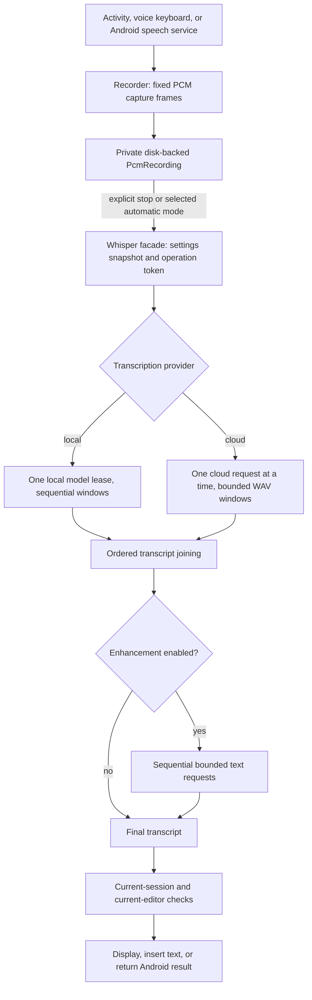

# ToneTunner: full engineering record of the cloud-dictation transition

Date: 20 October 2026. Last updated: 21 October 2026. This document explains the cloud-dictation design, the reasons for the important decisions, the sequence of work, the failed attempts and corrections, and the evidence boundaries. The recovery work passed a complete workflow at `11eda74`, before the later folder review added more regressions. The tests-first folder-review run `39525899701` on `01bd79c` was red as expected. The integrated fixes passed a complete workflow at `3a04b5f` ([run 39533439912](https://github.com/DevilVed/ToneTunner/actions/runs/39533439912)); [section 27](#27-integration-verification-addendum) records the repairs made on the way there. The detailed [per-finding review response](2026-10-21-detailed-review-response.md) and [clean-clone build recipe](build-recipe.md) record the new findings and build limits.

**Review correction:** Review found data-loss and behavioral regressions in the `bd0e80a` build described below. Its passing fixtures did not cover mid-dictation request failure, enhancement fallback, initial silence, microphone-read salvage, legacy/three-letter language codes, or host-driven selection changes adequately. The [review repair plan](superpowers/plans/2026-10-20-dictation-review-repairs.md) tracks the red evidence and replacement behavior. The repairs now represented by the current source retain finished audio and completed text for explicit retry or discard, while the original `bd0e80a` results remain historical evidence for that earlier build. The user explicitly chose private retention of failed dictations until retry/discard.

The historical application/build commit is `bd0e80a393040ff19fb4fd3373830fbb4c94d1b2`. The following `f580faa` commit changed only acceptance documentation. The recovery repairs described here are not represented by that build; their source and regression tests are committed later in this branch, and the replacement full-workflow result is still pending.

The work is on `agents/voiceink4android`, with [draft PR #133](https://github.com/DevilVed/ToneTunner/pull/133) targeting `beta-test-v1` (it originally targeted `master` and was retargeted on 21 October because this is a new feature that needs phone testing before release). The baseline fetched from GitHub was `f7519520f5c749ee74229f42f2e98da51105b64b`. No release tag or signed public release was created as part of this experiment.

## Reading guide and evidence boundaries

Read this document in order for the complete explanation. The accompanying [test inventory](2026-10-20-verification-test-inventory.md) lists the exact tests from the downloaded final reports. The original [design specification](superpowers/specs/2026-10-20-cloud-dictation.md), [implementation plan](superpowers/plans/2026-10-20-cloud-dictation.md), [runtime verification record](superpowers/plans/2026-10-20-runtime-verification.md), [native build documentation](../tools/native/README.md), and [user instructions](../README.md) preserve the more specialized records.

The explanations below describe engineering rationale supported by the requirements, implementation, recorded reviews, and Actions results. They do not reconstruct unrecorded deliberations or claim that every alternative was prototyped. A source-code property, a fixture test, an Android emulator observation, and a physical-phone/live-provider observation are different kinds of evidence. The document keeps those distinctions explicit.

Navigation: [requirements/baseline](#1-what-the-request-required-and-what-the-old-implementation-did), [work organization](#2-how-the-work-was-organized), [architecture](#3-the-central-architecture-decision-one-shared-dictation-pipeline), [independent stages](#4-why-transcription-and-enhancement-are-separate), [transport](#5-cloud-transport-decisions-and-their-consequences), [ZDR](#6-openrouter-zdr-what-was-implemented-and-what-was-not-established), [enhancement](#7-enhancement-correctness-prompt-structure-and-bounded-text), [credentials](#8-credential-storage-and-settings-state-decisions), [audio algorithm](#9-long-recording-research-and-the-algorithm-actually-chosen), [automatic mode/watchdogs](#10-automatic-silence-stop-gestures-and-the-limits-that-remain), [ownership/native lifetime](#11-audio-ownership-cancellation-and-native-model-lifetime), [Android contracts](#12-android-integration-result-contracts-and-sensitive-editors), [display policy](#13-why-display-timeout-required-two-separate-repairs), [language/translation](#14-language-translation-and-joining-results), [native compatibility](#15-why-native-libraries-became-part-of-this-feature-change), [APK size](#16-why-a-successful-build-still-needed-artifact-inspection), [CI](#17-the-cloud-verification-pipeline-in-order), [test interpretation](#18-tests-what-they-establish-and-what-their-fixtures-leave-open), [failed runs](#19-the-observed-failures-and-corrections), [commits](#20-commit-by-commit-implementation-trail), [historical build/current status](#21-historical-delivered-result-and-current-verification-status), [usage/reproduction](#22-how-to-use-and-reproduce-the-result), [remaining acceptance](#23-what-still-needs-to-be-established-before-treating-this-as-a-public-replacement), [source map](#24-source-map-for-reviewing-or-changing-the-implementation), [recovery addendum](#25-review-repair-addendum-durable-checkpoints-and-explicit-delivery), and [folder-review addendum](#26-folder-review-addendum-bounded-failure-recovery-and-platform-contracts).

## 1. What the request required, and what the old implementation did

The requested product was an open-source Android dictation application with the two capabilities valued in VoiceInk: user-supplied cloud API access and a separate enhancement model. The desired cost model was direct provider usage rather than a mandatory application subscription. The implementation does not contain a measured cost comparison or a promise that a particular provider/model is cheapest; provider prices, account policies, accuracy, and usage remain external variables.

The additional requirements changed the architecture substantially: manual recording had to survive thinking pauses, the recording limit had to disappear without an ever-growing audio buffer, local Whisper still had to work, and builds/tests had to run in GitHub Actions rather than on the Mac. The project identity, installed application ID, licenses, credits, Apache headers, and `.jules` records had to remain intact.

The original recorder provided a concrete explanation for the timer. At the baseline, `Recorder.recordAudio()` computed `sampleRateInHz * bytesPerSample * channels * 30`, accumulated audio in a `ByteArrayOutputStream`, and continued only while `totalBytesRead < bytesForThirtySeconds`. This was a **30-second** capture cap. The conversation also used “30-minute,” but the code being repaired enforced 30 seconds. Its VAD path additionally called `toByteArray()` on the accumulated recording to obtain the latest frame. Simply deleting the time condition would therefore have allowed the in-memory recording and copying cost to grow with duration.

The application already had Android delivery infrastructure: a standalone Activity, an input-method service/voice keyboard, an Activity for `RECOGNIZE_SPEECH`, and a `RecognitionService`. Reusing those entry points preserved useful Android behavior and avoided replacing the entire keyboard/intent integration just to add providers. The application ID remains `org.DevilVed.whisperplus`; the Java namespace remains `com.devilved.tonetunner`.

## 2. How the work was organized

Superpowers was used for design/planning, focused parallel work, regression testing, debugging, independent review, and verification before completion. Work was divided by responsibility rather than letting several workers edit the same integration files. Cloud transport/provider fixtures and settings/credential storage were separate implementation areas; the primary integration work connected the shared facade to the Android entry points. Later workers handled IME transition tests, native compatibility research, foreground-display regression tests, and scoped reviews.

The reason for this division was dependency control. The settings UI and transport needed an agreed `ProviderConfig` contract before they could be connected reliably. Keeping their initial ownership separate reduced conflicting edits, while the shared facade provided one place to decide which transcription and enhancement stages to run. Independent reviews then examined the assembled behavior, especially ownership, cancellation, credentials, and native-resource lifetime.

The strongest recorded tests-first evidence concerns specific runtime defects. The IME stale-listener/Activity-contract tests, capture-display tests, and pending-processing display tests were committed and run before their corresponding production repairs. Their failures and subsequent passing runs are listed later. This record does **not** claim that every line in the large initial implementation had a separately observed red-first test cycle.

No Android SDK, Gradle build, Java compilation, NDK compilation, emulator, or executable test suite was run locally. Local work consisted of source edits, static XML/Python syntax and diff inspection, reading downloaded reports, and inspecting downloaded archive/binary metadata. The build scripts ran on GitHub's Linux runners. No developer API key was provisioned, read for inference, or embedded; paid model calls were not used to validate this change.

## 3. The central architecture decision: one shared dictation pipeline

The final flow is:



`asr.Whisper` remains the facade used by the entry points, although it now coordinates more than the local Whisper model. Keeping that facade reduced duplicated orchestration: provider selection, settings snapshots, window iteration, optional enhancement, cancellation, result creation, and cleanup live in one place. The Android classes retain responsibility for permissions, visible state, editor eligibility, and delivering a result in the correct Android contract.

An alternative would have been to add an independent cloud implementation to each Activity/service. That would have multiplied the places where privacy filters, malformed responses, lifecycle cancellation, and future provider fixes could disagree. A new generic plugin framework would have been a larger abstraction than this change required. The chosen boundaries are concrete classes with a small interface: `Provider`, `ProviderConfig`, `CloudClient`, `AiSettings`, `SecretStore`, and the existing facade.

An operation snapshots both stage configurations, language/action, enhancement instructions, and vocabulary before asynchronous work starts. Changing settings while an operation is running therefore does not send later chunks to a different provider, endpoint, model, or key midway through that operation. The next operation uses the next snapshot.

The application uses Java 11 source compatibility, compile/target SDK 35, and minimum SDK 28 (Android 9). CI uses JDK 17, Gradle 8.14.5, Android Gradle Plugin 8.13.2, and the pinned NDK described below. This was an extension of the existing Java Android application, not a Kotlin/framework rewrite. The debug application retains versionCode 14/versionName 1.4; versioning for a public release was not performed implicitly by building an experimental branch.

## 4. Why transcription and enhancement are separate

Transcription converts the captured audio into words. Enhancement sends those words to a text model for punctuation, grammar, capitalization, and supported spelling cleanup. In this implementation “enhancement” is **text editing after transcription**. It is not microphone noise suppression, an audio denoising model, speaker separation, or an audio-waveform enhancement stage.

The stages are independent because the best user choice for audio recognition need not be the same provider/model as the choice for text cleanup. A user can use local Whisper without cloud enhancement, local Whisper with cloud enhancement, cloud transcription alone, or cloud transcription followed by another cloud model. Local transcription plus cloud enhancement still sends the transcript off the phone and therefore still requires cloud consent and cloud-eligible input.

Enhancement defaults off. This makes the extra data transfer, provider use, latency, and possibility of model rewriting an explicit choice. Disabling it leaves the transcription pipeline usable. The application supplies presets rather than forcing the user into a fixed model contract:

| Provider | Transcription preset | Enhancement preset |
|---|---|---|
| Groq | `whisper-large-v3-turbo` | `openai/gpt-oss-20b` |
| OpenAI | `gpt-4o-mini-transcribe` | `gpt-4o-mini` |
| OpenRouter | `openai/whisper-large-v3` | `openai/gpt-4o-mini` |
| Custom HTTPS | User-entered model ID | User-entered model ID |
| Local | Existing Whisper ONNX engine | Not a local enhancement option |

Fresh settings select Groq transcription and OpenRouter as the enhancement provider, with enhancement disabled, consent false, and no API keys. These are editable starting points, not accuracy/cost rankings or proof that the model is available in every account. A fresh installation cannot make a configured cloud dictation request until its owner supplies a key and saves consent.

Built-in providers can refresh model catalogs. Transcription and text-chat catalogs are filtered separately so that a text-only model is not presented as a transcription choice merely because both appear under one API account. OpenRouter's public catalog was inspected during the work and exposed transcription modality metadata; the recorded count of 26 entries was an observation on that date, not a permanent promise. Custom services keep manual model entry because a compatible inference endpoint does not necessarily expose a compatible discovery endpoint.

## 5. Cloud transport decisions and their consequences

`CloudClient` performs blocking requests off the UI thread through OkHttp 4.12.0. An operation owns its client and active call. Direct OpenAI-compatible transcription uses multipart form data containing the model and a WAV file. OpenRouter transcription uses its JSON `input_audio` shape with base64 WAV data. The provider abstraction shares common orchestration without assuming these payloads are identical.

Endpoints must be HTTPS. Built-in provider choices are constrained to their expected host and standard TLS port; custom endpoints permit a user-entered HTTPS host, nonstandard valid TLS port, and nonstandard full path. User-info credentials, query strings, and fragments are rejected. The full route is stored rather than guessing that every compatible service is exactly `/v1/audio/transcriptions`. An early settings/transport disagreement about custom paths/ports was corrected and covered by fixtures so a URL accepted by settings would not be rejected by the transport for a contradictory reason.

Redirect following and automatic connection retries are disabled. The rationale is explicit destination/cost control: a provider response should not silently redirect a credential-bearing inference request, and an uncertain connection failure should not automatically replay potentially billable work. This means a transient error is surfaced for the user to resolve rather than being hidden behind automatic retries. There is also no automatic switch to another provider.

The transport is bounded independently of recording duration:

| Limit | Current value | Purpose |
|---|---:|---|
| Connect timeout | 15 seconds | Bound connection establishment |
| Write timeout | 60 seconds | Bound stalled request upload |
| Read timeout | 75 seconds | Bound stalled response reads |
| Whole-call timeout | 90 seconds | Bound an individual network call |
| Response bytes | 1 MiB | Prevent an unbounded body read |
| Response-read chunk | 8,192 bytes | Read incrementally up to the cap |
| WAV input capacity | 30 seconds of PCM | Protect an individual request encoder |
| Actual pipeline audio window | At most 28 seconds | Stay inside the per-request/local window bound |

The remaining 30-second WAV constant is therefore not a recording timer. A long recording creates many requests of at most 28 seconds each. The per-call timeouts similarly do not cap total recording duration or the total duration of a multi-window operation.

HTTP 401/403 becomes a safe authentication message; 429 becomes a rate-limit message; 408/504 becomes a provider-timeout message; 413 becomes a request-size message. Other failures use a generic provider error. Raw response bodies are not displayed as errors because they may contain sensitive text, identifiers, or echoed request information. A body that lies about its length is still capped while it is read. Responses and active calls are closed/cleared on terminal paths.

## 6. OpenRouter ZDR: what was implemented and what was not established

ZDR is requested independently for transcription and enhancement, with both preferences defaulting true. Transcription requests add `provider.zdr: true` and `provider.data_collection: "deny"` when selected. Chat enhancement additionally uses routing settings that require supported parameters and disable provider fallback; ZDR/data-collection fields are added when selected.

The reason for stage-specific controls is that a local transcription stage does not make a cloud enhancement stage private, and a privacy requirement on audio does not automatically apply to a separate text request. Unsupported routing/privacy combinations must produce an error rather than silently weakening the request or switching providers.

This is request construction and routing policy enforcement by the application. It is not independent proof of a provider's retention practices, a modification to an OpenAI/Groq account's retention settings, or a guarantee that cloud data stays on the phone. The settings disclosure and README distinguish these responsibilities. Tests verify the outgoing filters and absence of an application fallback; they do not audit provider infrastructure.

## 7. Enhancement correctness, prompt structure, and bounded text

The enhancement system instructions require preserving meaning, avoiding invented facts, avoiding summaries/meaningful omissions, and returning only edited transcript text. The transcript is represented as quoted source data, with an instruction not to follow commands contained inside the dictated text. User cleanup instructions and vocabulary are added in a way that preserves those invariants. This reduces a predictable prompt-construction risk; it does not prove that an arbitrary model will never hallucinate or follow a malicious instruction.

The facade splits a long transcript into pieces of at most **3,000 UTF-16 characters**, preferring sentence/newline boundaries, then whitespace in the latter part of a window. Splitting avoids breaking a surrogate pair. Each piece is enhanced sequentially and joined in order. This prevents a very long recording from becoming one unbounded text-model request, at the cost of reducing context across piece boundaries. The implementation does not perform a final global rewrite over the entire result.

The client sets an 8,192-token output budget with the provider-appropriate parameter: `max_completion_tokens` for direct OpenAI/Groq and `max_tokens` for OpenRouter/custom. Additional defensive bounds include 500,000 characters for direct enhancement input/output validation and 16,000 characters each for instructions and vocabulary. The normal facade supplies 3,000-character pieces, so those larger client guards are secondary defenses, not the normal chunk size.

The request does not impose a temperature parameter on every selected model. Provider/model families differ in which controls they accept, so a supposedly universal tuning parameter can make a valid model unusable. The output budget, message shape, and parser are explicit; the application does not claim that every OpenAI-compatible service accepts every model or every parameter unchanged.

An empty output, refusal, malformed message, unsupported mixed content, content filtering, or `finish_reason: length` is an enhancement error. A supported array of text blocks is handled; unrelated/non-object blocks are rejected rather than partially accepted after valid text. Returning a truncated first half as successful dictation would be especially harmful after a long recording, so the parser still rejects incomplete enhancement output. The reviewed recovery behavior now treats enhancement as optional post-processing: the original complete raw transcript remains intact unless every enhancement piece succeeds. If enhancement fails, ToneTunner returns the complete raw transcript and adds a visible warning. That fallback protects already-recognized speech from being lost because of a later text-model failure; cancellation remains cancellation and leaves the saved item retryable.

## 8. Credential storage and settings-state decisions

Non-secret preferences hold provider choices, endpoint/model IDs, ZDR flags, consent, instructions, and vocabulary. API keys go through `SecretStore`, not ordinary preferences. The AES key is generated/retrieved using Android Keystore. Records use AES-GCM with a 12-byte IV and 128-bit authentication tag, versioned bounded records, and `AtomicFile` writes in the app's no-backup `ai-secrets` directory.

The credential identity is `provider + NUL + stage + NUL + trimmed full endpoint`. A SHA-256 of that identity names the record, and the identity is authenticated as GCM additional authenticated data. The consequence is more than separate filenames: moving ciphertext to another provider/stage/endpoint does not make it decrypt successfully under that new identity. This avoids accidentally reusing a transcription key for enhancement or sending an old key to a newly edited custom destination.

Blank key input preserves an already saved key for that exact identity. “Remove saved key” deletes the selected identity, not every key. This lets a person change a model or prompt without retyping a secret, while keeping destination changes explicit. Corruption, unavailable Keystore material, bad record lengths, or GCM authentication failure produces a safe storage error rather than plaintext fallback. Record reads are bounded, and temporary byte arrays are wiped where practical.

The settings window sets `FLAG_SECURE`; password inputs are masked and excluded from normal saved-view-state/autofill behavior. A key is not repopulated visibly from storage. Model discovery is asynchronous and uses lifecycle/generation checks so a stale response does not update a destroyed screen or the wrong selection.

These decisions protect storage and ordinary UI leakage. They do not mean secrets are absent from process memory: a request needs its key in an operation configuration and authorization header, and Java strings cannot be reliably erased as soon as they are used. Keystore does not make a rooted/compromised device harmless. The key is not configured to demand user authentication on every use, because repeated biometric prompts during voice-keyboard operations would prevent the intended interaction. The change does not claim a formal security audit or protection against every device-level compromise.

## 9. Long recording: research and the algorithm actually chosen

The sources were inspected for useful mechanisms, not copied indiscriminately:

| Reference | Useful observation | Decision for Android |
|---|---|---|
| [VoiceInk CoreAudioRecorder](https://github.com/Beingpax/VoiceInk/blob/main/VoiceInk/Infrastructure/Audio/CoreAudioRecorder.swift) | Preallocated capture buffers and file-backed output | Adopt bounded capture plus a file spool, using Android `AudioRecord` rather than Apple APIs |
| [VoiceInk local Whisper adapter](https://github.com/Beingpax/VoiceInk/blob/main/VoiceInk/Infrastructure/Providers/Transcription/Whisper/WhisperTranscriptionService.swift) | Local path reads the complete file into memory | Do not reproduce that whole-file memory behavior |
| [whisper.cpp stream example](https://github.com/ggml-org/whisper.cpp/blob/master/examples/stream/stream.cpp) | Bounded inference windows and retained context | Use bounded windows, but avoid a live inference backlog/audio-drop tradeoff |
| [faster-whisper VAD](https://github.com/SYSTRAN/faster-whisper/blob/master/faster_whisper/vad.py) | Bounded segments and silence-aware boundaries | Prefer quiet boundaries, while preserving every input frame instead of filtering speech |

The chosen design is **record first to disk, process sequentially after stop**. A live inference queue would require a backpressure policy when a local model is slower than speech: memory growth, capture blocking, or dropped audio. A disk spool keeps capture independent of inference speed. The tradeoff is that results are not streamed word-by-word during capture, and processing latency remains after stop.

The capture format is 16 kHz, one channel, signed PCM16. Its rate is:

```text
16,000 samples/second × 2 bytes/sample × 1 channel = 32,000 bytes/second
30 seconds = 960,000 bytes
30 minutes = 57,600,000 bytes (about 54.9 MiB)
1 hour = 115,200,000 bytes (about 109.9 MiB)
```

`Recorder` reuses a 960-byte frame, equivalent to 480 samples/30 ms. `PcmRecording` writes through a fixed 64 KiB output buffer to `noBackupFilesDir/dictation-audio`. The file is private to the app and excluded from backup; it is **raw PCM, not application-encrypted audio**. Credential encryption and audio-file privacy are separate mechanisms.

After capture is finished, `PcmRecording.nextChunk()` returns the next bounded byte window:

1. If the remaining audio is at most 28 seconds, return that remainder unchanged.
2. Otherwise establish a hard end 28 seconds ahead: **896,000 PCM bytes**.
3. Search at most the final eight seconds before that end, beginning no earlier than 20 seconds into the current window.
4. Examine 20 ms frames, each 640 bytes. A frame is quiet when mean absolute PCM amplitude is at most 256.
5. Require at least 300 ms of consecutive quiet frames. Prefer the midpoint of the latest qualifying quiet run.
6. If no qualifying quiet run exists, use the 28-second hard end and mark that window as a hard cut.
7. Read exactly that interval. A quiet-boundary window advances directly to its end. After a hard-cut window produces text, the next inference window is rewound by 500 ms of PCM16 audio so the model sees boundary context again; if the hard-cut window produces no text, it advances without rewind.

The energy check chooses boundaries; it is not a speech detector that removes supposedly unimportant frames. The midpoint reduces the chance of cutting directly against a spoken sound at the edge of a pause. The 500 ms rewind is limited to hard cuts: it gives the next inference request acoustic context around a clipped word, while the transcript joiner tries to remove duplicate text. A 28-second cap leaves space below the 30-second WAV request limit; the same 28-second bound also limits each local input window. This does not establish a separate 30-second capacity of the local recognizer. These are lightweight boundary heuristics, not learned VAD or guaranteed word alignment.

The numeric quiet thresholds and boundary-search range are engineering starting points. Fixtures verify their slicing, conservation, and bounded-allocation behavior; there was no recorded acoustic/word-error study establishing that 256 amplitude, 300 ms silence, or this search range is optimal for every voice, microphone, and language. Likewise, network/watchdog values are defensive operational defaults, not results of a phone/provider latency benchmark.

### What is and is not bounded

| Resource | Behavior as recording duration grows |
|---|---|
| Capture work array | Fixed 960 bytes |
| File output buffer | Fixed 64 KiB |
| Boundary scan allocation | At most eight seconds, about 256,000 PCM bytes |
| Returned PCM window | At most 896,000 bytes |
| Local float conversion | Up to 448,000 floats, about 1.79 MB, in addition to the PCM window |
| WAV/base64/HTTP representations | Bounded by one request window, with conversion copies/encoding overhead |
| Model weights/native inference | Additional memory determined by the engine/model; not measured as a fixed device-independent number here |
| Transcript and enhancement text | Grows with recognized text; text-window lists/builders also consume memory |
| Temporary audio disk space | Grows at approximately 32,000 bytes/second |

The accurate claim is bounded **audio staging per window**, not constant total application memory or infinite recording on finite storage. Local model inference may have its own allocations. This work prevents the full raw recording from becoming a growing RAM buffer and avoids overlapping model lifetimes; it does not establish a measured RAM ceiling on every phone.

Storage/write/read failures are errors rather than successful truncated recordings. Before cloud or local inference starts, every finished recording is moved into the private recovery store; each completed inference window advances an atomic metadata checkpoint while the full PCM remains present. Processing cancellation or failure therefore leaves the most recent checkpoint available for explicit retry. This restartable processing recovery does not make an unfinished live recording resumable: temporary capture audio can still be discarded when capture is cancelled or its foreground UI is torn down. Ordinary unretained temporary spools are still cleaned before a later capture, while retained recovery entries and recognized recovery-orphan files are excluded from that sweep.

The first processing pass checks RMS on successive 20 ms PCM frames, not across the entire inference window. If any frame exceeds 64 (about -54 dBFS), the whole window is kept for inference; a brief utterance is not diluted by a long silent remainder. This is fixed-amplitude filtering, not automatic gain control: samples are not normalized or amplified, noise above the threshold can still reach the model, and very quiet speech below it may be skipped. A typed provider no-speech response also allows processing to continue through later windows, so a long pause is not treated as a manual stop. If the complete recording yields no text, the saved checkpoint is reset to byte offset zero; an explicit retry can then replay the whole file. Explicit retry bypasses the quiet-window skip so a person can deliberately submit a quiet recording after checking it. There are no automatic network retries or automatic paid replays.

## 10. Automatic silence stop, gestures, and the limits that remain

Removing the capture cap did not remove optional silence-stop behavior. Manual capture does not initialize VAD. The user-selected automatic mode does: WebRTC VAD uses 16 kHz, 480-sample frames, very aggressive mode, 800 ms silence duration and 200 ms speech duration. After speech has been heard, VAD can end that automatic recording. A user who wants thinking pauses should use manual mode.

The reviewed recorder also bounds the initial-speech wait in automatic mode to 30 seconds, measured by captured samples or elapsed monotonic time. The guard is checked after a successful `AudioRecord.read`; it is not a separate watchdog capable of interrupting a platform read that blocks. This applies only while VAD is enabled and no speech has yet been heard. After initial speech, the existing automatic post-speech silence behavior applies; manual mode has no VAD initial-speech timeout and can preserve thinking pauses until explicit stop. The `bd0e80a` build lacked this initial timeout and could leave automatic capture open indefinitely without speech; that defect was demonstrated by the corrected red run and is covered by the current repair source. The service does not own the caller's Activity/window; it cannot impose the same display policy as the standalone Activity or visible keyboard.

The microphone gesture helper uses a 350 ms hold threshold. A short tap starts recording and leaves it active until another tap; holding retains push-to-talk behavior, stopping on release. This gives a practical way to make long recordings without holding a button for their full duration. Cancelled gestures do not request a successful transcription.

There are still bounded waits for stalled work. A local model lease waits up to 90 seconds, initialization waits up to 90 seconds, and each local window can wait up to 180 seconds for recognition. These are watchdogs for one stage/window, not a cap on the total recording. A sufficiently slow or failing phone can still hit them. Network calls retain the limits listed above. Available storage, microphone access, Android lifecycle, provider quotas, and model availability remain real limits.

## 11. Audio ownership, cancellation, and native model lifetime

Ownership was a major review topic because multiple Android entry points exist in one process. A global “last audio” slot allows one recorder or cancellation path to claim/delete another recorder's audio. The new path gives each `Recorder` its own completed `PcmRecording`. `takeRecording()` transfers that file to the operation that starts transcription. All entry points pass the owned recording explicitly to the facade.

`OperationGate` assigns a generation token and prevents overlapping work in a facade. Cancellation increments the generation, cancels the current HTTP call/future, and closes active reader/model resources. Because the completed recording was archived before inference, processing cancellation retains the last atomic checkpoint and full audio instead of deleting the sole copy. Queued main-thread callbacks check the token before updating UI or delivering results. Merely interrupting a thread would not be sufficient: network/native work can complete after cancellation, and a callback can already be waiting in the UI queue.

The IME adds editor-generation and Whisper-owner checks. A result started for field A must not be inserted into field B even if both are in the same app, and a listener retained before cancellation must not remain eligible merely because editor numbers happen to match. Host selection notifications alone do not cancel recording or pending processing: editors can move the cursor for ordinary formatting/composition while the same field remains active. Replacing or finishing the input, explicit cancellation, or leaving the foreground input session still invalidates the listener. These checks use editor metadata and identity, not surrounding text.

After processing succeeds, a delivery claim protects the retained entry while the callback runs. Each built-in entry point reports whether it accepted the result: the standalone UI updates its result, the IME reports the `commitText` result, the recognition Activity reports whether it prepared the Android result, and the recognition service treats a binder `RemoteException` as delivery failure. A stale listener or closed editor returns false. The saved item is deleted only after a positive acknowledgement; false delivery leaves it retryable. This is an acknowledgement at ToneTunner's entry-point boundary, not proof that another app persisted or used an Activity result after receiving it.

Local models need a second, process-wide lifetime rule. Two facade objects must not each allocate a large Whisper model at once. `LocalModelGate` is a fair single lease. The lease is returned only after `Recognizer.destroy(afterClose)` finishes native cleanup, not when Java first asks for cancellation. Otherwise one model could still be freeing tensors/sessions while the next one loads, recreating the memory spike this change is intended to avoid.

Within one local operation, the model is reused across its sequential chunks. Reinitializing for every 28-second window would waste considerable load time. At the end of audio inference it is closed before cloud enhancement, because text cleanup does not need the native model resident. Later local dictations therefore pay initialization cost again. That trades some repeated-start latency for releasing idle native memory and allowing other entry points to acquire the lease. Model initialization is lazy: opening settings or a keyboard does not load/download the ONNX engine.

The current local path checks for six files: `Whisper_initializer.onnx`, `Whisper_encoder.onnx`, `Whisper_decoder.onnx`, `Whisper_cache_initializer.onnx`, `Whisper_cache_initializer_batch.onnx`, and `Whisper_detokenizer.onnx`. This is the existing RTranslator Whisper-Small arrangement, not a generic loader for every arbitrary Whisper architecture. No claim is made that a different model's tensor shapes/token IDs work merely by renaming its files.

## 12. Android integration, result contracts, and sensitive editors

The standalone Activity displays the transcript and retains append, supported translation, Chinese conversion, and existing TTS behavior. The voice keyboard inserts through the current `InputConnection`. The recognition Activity returns `RESULT_OK` and `RecognizerIntent.EXTRA_RESULTS`; warnings use ToneTunner's documented extra. The `RecognitionService` uses framework callbacks and now maps concrete failure classes to framework codes: denied microphone permission to `ERROR_INSUFFICIENT_PERMISSIONS`, recorder failure to `ERROR_AUDIO`, automatic initial-speech timeout to `ERROR_SPEECH_TIMEOUT`, explicit/client cancellation to `ERROR_CLIENT`, empty/no-speech transcription to `ERROR_NO_MATCH`, and other processing/configuration failures to `ERROR_SERVER`. In the historical `bd0e80a` build, empty transcription and initial-silence handling were not mapped correctly; the red runs and current source describe the repair, while final repaired workflow confirmation is pending. Sharing inference does not make the Android entry-point delivery contracts interchangeable.

`InputPolicy` rejects `TYPE_NULL`, text password, visible-password, web-password, and numeric-password editors. An editor with `IME_FLAG_NO_PERSONALIZED_LEARNING` is blocked whenever transcription **or enhancement** is cloud-based; fully local dictation can be allowed there. This is a conservative policy based on metadata supplied by the host editor. The application does not read/upload clipboard contents, surrounding app text, or screen contents to produce context.

The stale-listener tests used a real service listener and `BaseInputConnection`-based editing fixture. They exposed a missing listener-owner guard after cancellation/selection transitions. The current repair keeps selection notifications from destroying a still-active editor session while retaining owner/generation checks for an actual editor replacement or finish. A listener that cannot safely deliver returns false, which leaves its retained recovery entry available.

The recognition Activity had used `singleInstance`. AOSP's Activity launch behavior can force a new task in that mode and cancel the original caller's activity-result route. Adding an `onNewIntent` handler would not repair that result contract. The fix uses standard per-request Activity instances. An instrumentation test launches the real Activity from a real calling Activity, supplies a deterministic recognizer result at the listener boundary, and verifies the actual Android result travels back to its caller.

## 13. Why display timeout required two separate repairs

Deleting the recorder's 30-second condition was necessary but insufficient. Both Activities cancel their session in `onPause`, and the IME cancels when its input view finishes/hides. Android screen-off can lead to those lifecycle transitions. A thinking pause could therefore still end a recording because the display went idle, even though no capture counter expired.

The first repair used `FLAG_KEEP_SCREEN_ON` for Activity capture and `View.setKeepScreenOn` for the visible keyboard root, releasing the policy when capture stopped. Tests first established that these policies were absent. That capture-only fix passed its tests.

Review then found a second concrete case: after a long recording stops, sequential transcription and enhancement can take longer than the screen's idle timeout. Releasing the display policy at stop allowed the same lifecycle cancellation to discard the pending result during processing. New tests held processing pending rather than letting a missing-audio error finish it immediately; they failed before the second repair.

The final policy lasts while `recording || processing` in the Activities and while `acceptRecording || processing` in the IME. Recorder DONE transitions directly to processing. Success, error, explicit cancellation, pause, and input-view teardown clear both state and display policy. A replaced input root clears the old view's flag and reflects current state on the new one. Terminal code must clear the processing boolean **before** updating the window flag; otherwise a stale `processing=true` would keep the display awake after failure/cancel.

This is foreground-session protection. It does not add a background microphone service or CPU wake lock, and it does not override a user's explicit power-button action or app/keyboard switch. Leaving the foreground still cancels the live session. If capture has finished and been submitted for processing, however, it was archived before inference, so cancellation preserves its last checkpoint for explicit retry/discard. The tradeoff is that a long foreground dictation/processing operation keeps the screen lit and uses battery; that behavior is visible and ends with the operation.

## 14. Language, translation, and joining results

Most audio windows meet at quiet boundaries and are disjoint. When a 28-second hard cut had text, the next request repeats 500 ms of audio; `TranscriptJoiner.appendOverlapping` then compares bounded transcript edges. It can remove a sufficiently strong match of two or more words, complete some partial-word/phrase overlaps, and inspect no more than 256 code points at each edge. This is a conservative heuristic, not acoustic alignment: it may leave a duplicate or remove an apparent textual repeat, especially across languages/scripts or model rewrites. The ordinary joiner avoids adding a space before punctuation and avoids inserting spaces between adjacent Han, Hiragana, Katakana, or Thai characters. `TextWindows` preserves Unicode surrogate pairs.

The existing Chinese simplified/traditional conversion is applied in the appropriate result paths. Language/action settings are snapshotted per request; external recognition-Activity language extras are sanitized. The reviewed normalizer validates the whole language-tag form before reducing a valid BCP-47-like tag to its language code; it maps legacy aliases `iw` to `he`, `in` to `id`, and `ji` to `yi`, maps known ISO 639-3 codes to their two-letter forms, and preserves valid three-letter-only codes such as `yue` and `haw`. In automatic mode the first usable language metadata returned with a nonempty transcription is saved and pinned for later windows and retry. Providers may omit language metadata; in that case ToneTunner cannot pin a detected language and later automatic windows can be detected independently. This is a metadata limitation, not a claim of guaranteed cross-window language consistency.

Translation to English is explicitly narrower than transcription. The direct supported cloud combinations are Groq `whisper-large-v3` and OpenAI `whisper-1`. Groq Turbo, the default OpenAI mini transcription model, OpenRouter, and custom cloud routes are not treated as equivalent translation endpoints. Unsupported combinations fail before uploading audio. This avoids returning transcription in the source language while presenting it as a successful translation. Local translation retains the existing engine path; its real speech quality still requires phone/model testing.

## 15. Why native libraries became part of this feature change

Keeping local Whisper means shipping native ONNX/Extensions/VAD libraries even when a user chooses cloud mode. A JVM test can pass while Android refuses to load a native library on a different memory-page environment. The original APK was inspected rather than trusting dependency version labels, and Android lint's 16 KB warnings were elevated to a blocking error.

ONNX Runtime Android 1.27.0 and WebRTC VAD 2.0.10 provided compatible artifacts. The published Android Extensions 0.13.0 artifact still contained 4 KB-aligned native libraries; an appropriate newer Android AAR was not available in the inspected publication channel. Suppressing lint, deleting the local option, or only realigning the outer APK would have hidden or sidestepped the compatibility problem rather than fixing it.

Two alignment layers matter. ELF `PT_LOAD` segment alignment belongs inside each `.so`. ZIP payload alignment belongs to where an uncompressed native library is stored in the APK. `zipalign` cannot change bad program headers inside a library. The pipeline checks both, and additionally runs Android on an actual 16 KB emulator environment.

The chosen rebuild pins Extensions source revision `9d5638b0b1f28ed2ca9ef589d5ec3ea86f859432`, verifies the published base AAR SHA-256 `cb98c6fbeac1a9707228c4b76cfbb395b4dc4d310900aefaa672561d17fd6d9d`, preserves its Java classes/resources, and replaces the two JNI libraries for all four ABIs. It rejects an unexpected JNI package layout. The upstream MIT license and provenance are retained, and the APK includes a license asset. This avoids depending on a silently modified, untraceable binary.

The build uses NDK `27.2.12479018`, API 28, audio/Java support, static C++ linkage, flexible page size support, and shared/module linker flags `-Wl,-z,max-page-size=16384 -Wl,-z,common-page-size=16384`. The first NDK 28 attempt reached C++ compilation but failed because the pinned Dlib source used generic `std::char_traits<unsigned int>`, removed by LLVM 19's libc++. NDK 27 retained that source compatibility while supporting flexible 16 KB pages. The correction was therefore a compatible explicit toolchain, followed by the same alignment/runtime gates, not a claim that an older compiler automatically guarantees compatibility.

An earlier CI attempt also showed `sdkmanager` was not on PATH; the fix uses the runner SDK's explicit `cmdline-tools/latest/bin/sdkmanager` path. The successful cold native build took more than the old 20-minute dependency-analysis job limit, so code-check time limits were adjusted to accommodate measured native preparation. The rebuilt AAR is cached by build-script content and shared as an artifact. There is no fallback to the unaligned Maven AAR.

## 16. Why a successful build still needed artifact inspection

The first fully verified whole-session build produced a universal debug APK of **383,666,126 bytes**, about 366 MiB. Its Actions log said native libraries could not be stripped. ELF metadata showed more than 50 MB of debug sections in one arm64 Extensions JNI library alone. The app could load and run while still carrying unnecessary debug data in the package.

The root issue was toolchain preparation in the packaging jobs. A rebuilt AAR cache is not an NDK installation on the next runner. Gradle now pins the same NDK as the native build, and every Android build/test/release/code-check path prepares it explicitly, including cache hits. A reviewer caught the initially uncovered release/code-check paths before final acceptance. This correction did not require rebuilding native source locally or weakening the existing native cache.

The resulting artifact is **172,099,534 bytes**, 164.13 MiB. Local metadata inspection of the downloaded cloud output found 20 native libraries across `arm64-v8a`, `armeabi-v7a`, `x86`, and `x86_64`, with no `.debug*` sections. The GitHub artifact ZIP is about 69.3 MB. The archive digest reported by GitHub is not the same thing as the SHA-256 of the extracted APK; the APK checksum below is computed from the actual downloaded APK.

The debug APK is still large because it is universal and includes native engines for four ABIs. Local model weights are not bundled in that size. The existing release configuration filters arm64, but a final signed release artifact was not produced/measured here, so this record does not promise its exact size.

## 17. The cloud verification pipeline, in order

`.github/workflows/android-build.yml` uses these gates:

1. Run the six artifact-validator tests; restore the pinned native AAR from cache or rebuild it; validate its 64-bit ELF libraries; upload the AAR.
2. Download that AAR in the verification job; prepare JDK 17, Gradle 8.14.5, SDK/NDK; run `testDebugUnitTest` and `lintDebug` with failure reports uploaded.
3. Only after JVM/lint success, run connected tests on API 28 `google_apis` x86_64/4 KB, API 34, and API 35 `google_apis_ps16k` x86_64/16 KB. The tests assert the actual page size where relevant, not merely the matrix label. The new API 34 matrix entry and API 35 bound-service test were added after the red tests-first run; their integrated execution remains pending.
4. Only after both Android jobs succeed, assemble the final APK with the same native artifact and pinned toolchain.
5. Run APK ZIP alignment and ELF checks; upload the APK only when these pass.

Native dependencies must be compiled before native compatibility can be tested. Android instrumentation also necessarily assembles test/application packages in order to run them. Thus “tests before build” means the **final deliverable APK assembly/upload is gated by verification**; it cannot mean that no compiler or test-package assembler runs before a test executes.

Reports are retained even on failure. New pushes to the same workflow concurrency group can supersede older runs. Some intermediate runs were cancelled during packaging after their useful test jobs had passed; the final acceptance uses a completely successful run rather than treating a cancelled run as an overall success.

Release and code-check workflows were updated for the same native preparation/NDK requirements and received static review. The final Android build run is not evidence of a signed release, a completed CodeQL scan, or a fresh dependency-security assessment. The automatic “vulnerabilities on default branch” message from GitHub pushes is not a validated finding set for this patch.

## 18. Tests: what they establish and what their fixtures leave open

The **historical `bd0e80a` evidence** comprises 121 JVM tests in 21 suites, six native artifact-validator tests, and six connected Android tests in each of two environments. Those counts and the [inventory](2026-10-20-verification-test-inventory.md) describe that build only; they do not cover or verify the later repairs. The first complete recovery-repair checkpoint, [39524551595](https://github.com/DevilVed/ToneTunner/actions/runs/39524551595) on `11eda74`, passed 193 JVM tests in 26 suites, lint with zero errors/39 warnings, the native gate, API 28 and API 35 connected jobs, and APK packaging. That run predates the folder-review changes. Tests-first folder-review run [39525899701](https://github.com/DevilVed/ToneTunner/actions/runs/39525899701) on `01bd79c` reported 226 tests in 29 suites, 26 failures, and zero errors/skips; the current integrated fixes still need a complete workflow.

The JVM/provider tests cover multipart/JSON bodies, ZDR fields, catalog filtering, custom endpoint acceptance/rejection, translation rejection before upload, safe errors, redirects, empty/no-speech versus malformed results, enhancement refusal/truncation/content shapes/size bounds, and cancellation of an in-flight HTTP fixture. They exercise controlled HTTP responses rather than making paid requests to production providers.

Credential tests exercise real AES-GCM with an injected test key source, encrypted persistence, identity separation, moving ciphertext between identities, corruption, unavailable keys, removal, and concurrent writes. Android instrumentation separately exercises the production Android Keystore implementation. These are complementary; a JVM crypto fixture alone would not establish Android Keystore behavior.

Spool/ownership tests exercise ordered bounded windows, exact test-data conservation, quiet-boundary selection, all-silence handling, hard-cap fallback, partial-sample rejection, finish/read/write ordering, idempotent close, read failure cleanup, stale-file removal, and preservation of live files. They do not amount to a measured low-disk/ENOSPC endurance run on a physical phone.

The connected tests do six concrete things:

| Connected test | Real component exercised | Important boundary |
|---|---|---|
| Page size | Android `Os.sysconf` | Confirms actual 4 KB/16 KB runtime |
| Credential persistence | Production Keystore/settings | Uses a synthetic credential, not a user account |
| ONNX/Extensions | CPU native inference and registration | Uses a self-generated Identity graph, not full Whisper weights or speech accuracy |
| VAD | Native VAD library/frame call | Silence fixture, not a physical acoustic benchmark |
| Speech intent | Real caller/child/result routing | Recognition result is supplied deterministically at the real listener boundary |
| Long capture | Actual Android `AudioRecord` and spool | Emulator microphone runs beyond 30 seconds, then explicit stop and multi-window cleanup; not Bluetooth/physical mic quality |

The Activity display-policy tests seed active state and invoke real installed listeners with a recorder stub. The IME tests use the actual record button and installed recorder/listener paths, with narrowly scoped shadows to suppress real microphone/inference work and hold processing pending. They check Window/View flags and terminal state transitions; they do not physically wait for an OEM display to time out. Generation/owner checks and callback-race tests establish specific stale-delivery protections, not exhaustive proof over every possible interleaving.

The repository also contains an existing `ZipSlipSecurityTest.java` with a standalone `main()` and private helper methods rather than JUnit annotations. It is not among the historical JUnit report suites and is not counted as an executed/passing security test here. Its existence is not evidence of a completed security scan. The 193-test recovery checkpoint passed selected storage, delivery, and recovery regressions. Both emulator environments in that checkpoint were x86_64; other ABIs were packaged/inspected but not executed on physical ARM devices. The later folder-review red run added tests for main-thread credential/archive work, short-speech dilution, local sentinel handling, destination exceptions, physical spool-prefix salvage, chronology, CJK/Thai overlap, fullwidth boundaries, translation preflight, recognition-service event timing, IME restart identity, stale foreground status, manifest/launch flags, catalog response caps, enhancement shortening, and safe HTTP errors. The 26 red assertions were expected at the tests-first checkpoint; the report is not evidence that their production repairs now pass. The final integrated report and artifact remain pending.

## 19. The observed failures and corrections

| Stage/run | Observed evidence | Correction or interpretation |
|---|---|---|
| [39424630888](https://github.com/DevilVed/ToneTunner/actions/runs/39424630888), `a557435` | Activity compilation failed on the stale `failCurrentSession(long, int)` helper call | Route recording failure through the existing appropriate Activity error callback; this was an integration compiler error, not a behavioral test failure |
| [39424952818](https://github.com/DevilVed/ToneTunner/actions/runs/39424952818), `c43d689` | Test compilation failed because `java.security.KeyGenerator` does not exist | Import AES `KeyGenerator` from `javax.crypto`; this was a test compiler error |
| [39425136179](https://github.com/DevilVed/ToneTunner/actions/runs/39425136179), `6dc4e44` | 97 JVM tests passed; lint zero errors/44 warnings; APK assembled | First cloud implementation checkpoint; native/platform evidence was still incomplete |
| [39431452697](https://github.com/DevilVed/ToneTunner/actions/runs/39431452697), `49e4fc1` | 105 tests; three expected failures; nine native alignment lint errors | Add Whisper-owner guards, remove `singleInstance`, repair native compatibility |
| [39433317136](https://github.com/DevilVed/ToneTunner/actions/runs/39433317136), `21d7058` | SDK manager command unavailable on PATH | Use explicit SDK manager path |
| [39433594177](https://github.com/DevilVed/ToneTunner/actions/runs/39433594177), `1d58039` | NDK 28/LLVM 19 Dlib `char_traits` compile failure | Pin compatible NDK 27.2 with explicit flexible page support and unchanged alignment gates |
| [39434614698](https://github.com/DevilVed/ToneTunner/actions/runs/39434614698), `b04b0b2` | Native rebuild, 105 JVM tests, both six-test Android jobs, APK gates passed | Native and Android-contract acceptance checkpoint |
| [39439137335](https://github.com/DevilVed/ToneTunner/actions/runs/39439137335), `db9e413` | 113 tests; six expected missing-awake assertion failures | Implement capture display policy |
| [39439954232](https://github.com/DevilVed/ToneTunner/actions/runs/39439954232), `2fe45ed` | 113 JVM tests and both Android jobs passed; run cancelled before final packaging was accepted | Capture-only policy worked; review exposed pending-processing gap, so the run was superseded |
| [39441333114](https://github.com/DevilVed/ToneTunner/actions/runs/39441333114), `b62a4e1` | 121 tests; 13 expected pending-processing awake failures; zero errors/skips | Extend policy through transcription/enhancement and clear terminal states in correct order |
| [39442114719](https://github.com/DevilVed/ToneTunner/actions/runs/39442114719), `2a17ad1` | All 121 JVM, native, Android and APK gates passed | Whole-session behavior accepted; downloaded artifact exposed debug-symbol bloat |
| [39444083490](https://github.com/DevilVed/ToneTunner/actions/runs/39444083490), `eae1cf4` | Run cancelled after review found that native-tool preparation also needed to cover other workflow/cache-hit paths | Superseded by `bd0e80a`, which prepares the pinned NDK in release/code-check paths as well as debug/test paths |
| [39444393039](https://github.com/DevilVed/ToneTunner/actions/runs/39444393039), `bd0e80a` | Complete successful run, stripped APK, counts below | Successful evidence for the historical build only; later review established that its fixtures missed critical recovery regressions |
| [39455119668](https://github.com/DevilVed/ToneTunner/actions/runs/39455119668) | Repair-regression run: 145 tests, 23 failures, zero errors/skips; 22 assertions reproduced known defects and one recorder fixture failed for an obsolete assumption | Historical red evidence; the recorder fixture was revised before the corrected timeout run |
| [39456006799](https://github.com/DevilVed/ToneTunner/actions/runs/39456006799) | Corrected repair-regression run: 145 tests, 23 failures, zero errors/skips; initial-silence test reached the recorder and confirmed automatic VAD did not stop without initial speech; the late-read prefix-salvage assertion also failed as expected | Historical red evidence used to confirm the initial-speech timeout and prefix-salvage gaps before repair; not a final verification run |
| [39458939215](https://github.com/DevilVed/ToneTunner/actions/runs/39458939215), `8aaa591` | 183 tests in 25 suites; five failures, zero errors/skips. One new negative case exposed a thrown `AudioRecord.read()` exception; two multipart parsers made an incorrect header assumption; two recovery-dialog assertions ran before posted AppCompat handlers | Recorder now salvages the captured prefix after thrown reads; fixture parsers handle OkHttp part headers and dialog tests drain the paused looper. The assertions were corrected without weakening their behavior |
| [39460337903](https://github.com/DevilVed/ToneTunner/actions/runs/39460337903), `b20fe1c` | 186 tests in 25 suites; three failures, zero errors/skips. One result-delivery rejection case still failed. Two positive OpenAI/Groq translation cases exposed production request-construction null-pointer bugs when an absent normalized language was passed into the request | These were real translation-path defects, not fixture errors. Commit `5c125bc` corrected the request construction by omitting the empty language value and completed acknowledgement handling; the full 186-test suite then passed before the next two service-fixture failures |
| [39460901923](https://github.com/DevilVed/ToneTunner/actions/runs/39460901923), `5c125bc` | 193 tests in 26 suites; two failures, zero errors/skips. The recovery/delivery assertions and five IME acknowledgement cases passed. Both failures stopped in RecognitionService fixture setup because reflection selected API 28's synthetic access constructor with a `RecognitionService$1` marker instead of the actual callback constructor. Native verification passed; runtime/APK jobs were skipped | Commit `37744fa` changed the selector to choose the shortest constructor; that heuristic was still wrong under Robolectric because its empty instrumentation constructor leaves `mListener` null |
| [39461474190](https://github.com/DevilVed/ToneTunner/actions/runs/39461474190), `37744fa` | 193 tests in 26 suites; two failures, zero errors/skips. Both failures were service-delivery fixtures that selected Robolectric's empty instrumentation constructor, leaving `mListener` null and throwing before the callback behavior could be exercised. The production cases passed | Commit `11eda74` now selects the actual API 28 callback constructor by its AOSP signature, `(RecognitionService, IRecognitionListener, int)`; the first two parameters include the implicit outer service instance. The framework declaration is visible in [Android 9 AOSP `RecognitionService.java`](https://raw.githubusercontent.com/aosp-mirror/platform_frameworks_base/android-9.0.0_r1/core/java/android/speech/RecognitionService.java) |
| [39462643721](https://github.com/DevilVed/ToneTunner/actions/runs/39462643721), `084cd96` | Repeated the two service-fixture failures against the same application/test source as `37744fa`; `084cd96` only added a `.gitignore` entry for local review notes | Repository housekeeping did not change recovery or production behavior. The callback constructor selector was corrected afterward in `11eda74` |
| [39524551595](https://github.com/DevilVed/ToneTunner/actions/runs/39524551595), `11eda74` | Complete green workflow: 193 JVM tests in 26 suites, zero failures/errors/skips; lint zero errors/39 warnings; native, API 28 and API 35 connected jobs and APK packaging passed | Green evidence for the recovery repair checkpoint only; the folder-review tests and source changes came afterward |
| [39525899701](https://github.com/DevilVed/ToneTunner/actions/runs/39525899701), `01bd79c` | Tests-first folder-review run: 226 tests in 29 suites, 26 failures, zero errors/skips. The native gate passed, but the red JVM gate prevented the then-configured API 28/API 35 runtime and APK jobs | The failing assertions identify behaviors to repair. API 34 was not in the matrix yet, and the added bound-service test did not execute on API 35; integrated full-workflow verification remains pending |

This sequence matters because the first green helper suite did not end verification. Runtime contracts, native compatibility, idle-screen behavior during both stages, final package metadata, and later dictation-recovery cases each exposed separate issues. The `bd0e80a` run is historical, and `39524551595` is a green checkpoint for the recovery fixes at `11eda74`. The later folder-review run `39525899701` is deliberately red and supersedes that checkpoint for the newly added issues; the current integrated source has no final green workflow yet. Compiler/setup and fixture failures are distinguished from production assertion failures throughout the ledger.

## 20. Commit-by-commit implementation trail

| Commit | Meaning in the change |
|---|---|
| `a557435` | Integrated cloud transport, enhancement/settings, shared orchestration and bounded long recording |
| `c43d689` | Corrected recognition Activity recording-error callback integration |
| `6dc4e44` | Corrected the AES key-generator test import |
| `a65e6e6` | Recorded initial cloud verification; documentation-only |
| `49e4fc1` | Added Android runtime and IME/editor-transition gates before their repairs |
| `21d7058` | Repaired speech result routing and introduced aligned native rebuild path |
| `1d58039` | Corrected SDK manager path |
| `b04b0b2` | Pinned compatible NDK 27 and explicit flexible page support |
| `344ccaa` | Added Activity display-policy regression coverage |
| `25a9e1c` | Added voice-keyboard display-policy regression coverage |
| `db9e413` | Documented the earlier green native/Android checkpoint; the subsequent run intentionally exercised the new awake-policy regressions and failed as recorded above |
| `2fe45ed` | Implemented capture display policy |
| `b62a4e1` | Added pending-processing display regressions and refined the requirement |
| `2a17ad1` | Implemented whole-session display policy |
| `eae1cf4` | Prepared pinned NDK for stripping in Android build/test jobs |
| `bd0e80a` | Extended toolchain preparation to every workflow path |
| `f580faa` | Recorded final cloud/Android acceptance; documentation-only |
| `b24594e` | Added tests-only regressions for recovery/data loss, microphone failures, and output behavior before changing the production fixes |
| `def7cfa` | Corrected a test helper and added language-response metadata coverage; the automatic-silence fixture still failed before reaching the recorder |
| `5815220` | Reworked the automatic-silence fixture to avoid native VAD instrumentation; produced the clear 23-failure red gate for the review defects |
| `8aaa591` | Implemented saved-dictation recovery, completed-window checkpoints, UI retry/discard, enhancement fallback, recorder salvage, and related joining/language corrections |
| `b20fe1c` | Added result-acknowledgement and supported-translation regressions; positive translation cases exposed a real request-construction bug when language metadata was empty |
| `5c125bc` | Fixed translation request construction, added delivery acknowledgement across the entry points, and retained completed dictations until the destination accepts the result |
| `37744fa` | Tried selecting the shortest RecognitionService callback constructor; under Robolectric this selected an empty instrumentation constructor, so the two service fixtures still failed before exercising callback behavior |
| `084cd96` | Added a `.gitignore` entry for local review notes; repository housekeeping only, with no product-source or test behavior change |
| `11eda74` | Selected the exact API 28 callback constructor by AOSP signature `(RecognitionService, IRecognitionListener, int)`; its recovery checkpoint later passed run `39524551595` |
| `01bd79c` | Added tests-first folder-review regressions; run `39525899701` was red with 26 expected failures before integrated repairs |

The recovery repair source and regression tests are committed in the sequence above. The complete run `39524551595` passed on `11eda74`, including the RecognitionService fixture after it began selecting the exact API 28 framework constructor. That success is a checkpoint for the recovery repair only: folder-review tests and later source changes followed it. Do not use the `bd0e80a` artifact as proof of the recovered behavior.

PR creation initially failed through the CLI because its token lacked pull-request creation permission. The connected GitHub app created [draft PR #133](https://github.com/DevilVed/ToneTunner/pull/133), and the PR was attached to this task. No token was printed or copied to work around that permission. Documentation requested afterward is added to the same feature branch/PR.

## 21. Historical delivered result and current verification status

| Item | Historical `bd0e80a` result only |
|---|---|
| Application/build commit | `bd0e80a393040ff19fb4fd3373830fbb4c94d1b2` |
| Final Actions run | [39444393039](https://github.com/DevilVed/ToneTunner/actions/runs/39444393039), success |
| JVM tests | 121 in 21 suites; zero failures/errors/skips |
| Native validator tests | Six passed |
| Connected tests | Six on API 28/4 KB and six on API 35/16 KB; zero failures/errors/skips |
| Lint | Zero errors, 38 warnings |
| APK validation | ELF/ZIP alignment passed; ten 64-bit native libraries checked |
| All-ABI package inspection | 20 native libraries across four ABIs; no native debug sections; Extensions license asset present |
| APK artifact | [ToneTunner-agents-voiceink4android-bd0e80a-debug](https://github.com/DevilVed/ToneTunner/actions/runs/39444393039/artifacts/12277090921) |
| Raw APK size | 172,099,534 bytes / 164.13 MiB |
| APK SHA-256 | `7955053f832a1a26e9feb666334119f05267126db62db52cc69b3041b70cd931` |
| Integration state | Experimental feature branch, draft PR #133 to `beta-test-v1` |

These values remain useful for identifying the earlier APK and reproducing its build, but they are not evidence for the review repairs. The 38 lint warnings concern dependency/toolchain and layout/style recommendations; “zero errors” does not mean “zero warnings.” Native 16 KB alignment errors were repaired rather than suppressed. The scoped reviews that preceded `bd0e80a` did not inspect the later checkpoint, retention, or delivery-acknowledgement changes.

| Current repair evidence | Status |
|---|---|
| Recovery repair source | Committed in `8aaa591`, `5c125bc`, and follow-up fixture commits; the `bd0e80a` artifact predates it |
| Most recent complete green checkpoint | [39524551595](https://github.com/DevilVed/ToneTunner/actions/runs/39524551595) on `11eda74`: 193 JVM tests / 26 suites, lint zero errors/39 warnings, native gate, API 28 and API 35 connected jobs, and APK packaging passed |
| Tests-first folder-review run | [39525899701](https://github.com/DevilVed/ToneTunner/actions/runs/39525899701) on `01bd79c`: 226 tests / 29 suites, 26 failures, zero errors/skips. Native passed; the red JVM gate prevented downstream runtime/APK jobs |
| Runtime matrix added afterward | API 34 was added to the configured matrix and an API 35 bound-service test was added; neither has completed in a green integrated workflow |
| Final integrated workflow and APK evidence | Pending a complete workflow on the final integrated SHA; do not infer success from the green recovery checkpoint or red tests-first run |

## 22. How to use and reproduce the result

For cloud dictation, the eventual repaired debug APK should be installed on a test phone, then AI settings should be configured with a transcription provider/model/endpoint, that destination's key, and the cloud disclosure. Enhancement can be enabled and configured independently with its provider/model/key/instructions/vocabulary. Grant microphone access, enable ToneTunner's voice keyboard in Android settings, and select it in a normal text editor. A short tap starts manual recording; another tap stops it and starts processing. Keep the app or voice keyboard visible if the foreground operation should continue. Leaving cancels active processing, while a finished recording that has been archived remains retryable. The historical `bd0e80a` APK is not the repaired artifact and should not be used to verify saved-dictation behavior.

For local operation, choose Local Whisper and use Install local model. Enhancement must also be off for a fully local request. The local loader still expects the six-file model set described above. Selecting an arbitrary downloaded ONNX model does not make it supported automatically.

To reproduce **all branch workflow gates** in GitHub Actions, use the branch for both the workflow definition and checked-out application ref:

```sh
gh workflow run android-build.yml --repo DevilVed/ToneTunner \
  --ref agents/voiceink4android \
  -f ref=agents/voiceink4android -f build_type=debug

gh run list --repo DevilVed/ToneTunner \
  --branch agents/voiceink4android --workflow android-build.yml

gh run view <run-id> --repo DevilVed/ToneTunner

gh run download <run-id> --repo DevilVed/ToneTunner \
  --name <artifact-name> --dir <download-directory>
```

Using `--ref` matters because dispatching the old workflow definition from another branch while merely supplying a checkout input is not necessarily the same verification pipeline. The repository has no application `gradlew` on the baseline; CI selects Gradle directly. The native upstream checkout has its own build machinery, confined to the cloud job. A cold native cache takes substantially longer than a warm cache.

The historical APK is a debug build, not a signed public release. A repaired debug APK has not yet been accepted by a complete workflow. Android update compatibility depends on its signing certificate as well as application ID/version; the unchanged ID does not guarantee a debug artifact can update a differently signed installed release. Phone testing should preserve existing user data. Publishing later requires the repository's release/version/signing process and the maintainer's decision; it was not done implicitly by this experiment.

## 23. What still needs to be established before treating this as a public replacement

The implementation is not evidence of parity with every VoiceInk/Wispr Flow feature or of equal recognition accuracy. No floating overlay, streaming partial text, general arbitrary-local-model support, background microphone service, or offline enhancement model was added. Installing the voice keyboard does not redirect every other keyboard's microphone button; host keyboard/service integration differs.

Finished recordings successfully archived by the processing facade are restartable from their last saved checkpoint: ToneTunner retains the **full original PCM file**, the completed transcript prefix, the checkpoint offset, and the overlap/language/action metadata. A retry opens that full file at the saved offset and continues from the last complete inference window; it does not delete the already-transcribed prefix or truncate the audio before the checkpoint. The saved item does not expire automatically. The user can explicitly retry or discard it, and ToneTunner removes it after a positive result-delivery acknowledgement. By contrast, an unfinished live capture is not a recovery entry: pressing cancel or leaving/tearing down its foreground UI releases and deletes the temporary recording. No background microphone operation was added. Process death during active capture or before archive completes is outside the retained-processing guarantee.

The recovery store is app-private, excluded from backup, and contains **plaintext audio and transcript metadata**; it is not application-encrypted. Retained entries consume storage until user discard or acknowledged delivery. An explicit retry uses the current AI provider/model/settings, so it can make a new billable request; ToneTunner does not automatically retry network failures, switch providers, or replay billable work. The archive attempts a primary and a second private root and can retain a recognizable orphan spool if both roots cannot be initialized. A full disk or broader filesystem failure can defeat both the archive and orphan rename, so persistence cannot be guaranteed when the device cannot write or rename the data.

The remaining practical checks are:

1. On a physical phone, configure each intended provider with the owner's key and verify authentication, catalog discovery, transcription, enhancement, ZDR rejection behavior, and account billing/retention settings. Fixture success is not account availability or retention proof.
2. Dictate actual long speech with pauses, background noise, vocabulary, language changes, punctuation, and non-Latin text. Assess quiet-boundary segmentation, the 500 ms hard-cut context and heuristic transcript deduplication, enhancement pieces, and model accuracy. No WER/quality benchmark was run here.
3. Exercise several OEM keyboards/editors, password/private fields, cursor moves, keyboard switches, rapid stop/cancel, rotation/backgrounding, manual screen-off, and returning to the app. The automated tests cover selected contracts, not all OEM behaviors.
4. Test a physical microphone and Bluetooth headset. The existing SCO routing behavior was not established as correct on physical hardware by an emulator capture.
5. Install the real local model and measure load time, per-window inference latency, memory, thermal behavior, battery, and the 90/180-second watchdogs on intended phones. Identity-graph CPU inference verifies the native stack, not Whisper's quality/performance.
6. Exercise realistic storage pressure and process termination both during active capture and after the recording has been archived for processing. Confirm that the last atomic checkpoint and full file remain retryable, and establish the limits when storage operations fail. Retained audio is not securely erased or application-encrypted; active capture before archiving is not resumable.
7. Review remaining lint/dependency findings and run the desired release/CodeQL checks before a distribution decision. The signed release workflow was statically reviewed but not executed as part of the delivered Android build.

These are not hidden successful tests. They are the boundaries of the evidence and the next acceptance work for a maintainer preparing a public release.

## 24. Source map for reviewing or changing the implementation

Paths below are relative to `app/src/main/java/com/devilved/tonetunner/` unless otherwise stated.

| File/component | Responsibility and reason to inspect it |
|---|---|
| `AiSettingsActivity.java` | Two-stage settings UI, key fields, discovery lifecycle, consent/save behavior |
| `cloud/Provider.java`, `cloud/ProviderConfig.java` | Provider presets and immutable per-stage configuration |
| `cloud/AiSettings.java` | Preferences, configuration validation, exact saved-key identities |
| `cloud/SecretStore.java` | Keystore/AES-GCM storage, AAD, bounded records and atomic writes |
| `cloud/CloudClient.java`, `cloud/AudioWav.java` | Payload compatibility, privacy parameters, caps, timeouts, parser/error behavior |
| `asr/Whisper.java` | Operation snapshot, window orchestration, local/cloud selection, enhancement, callbacks and cleanup |
| `asr/OperationGate.java` | Cancellation generation/busy ownership |
| `asr/LocalModelGate.java` | Process-wide native model lease |
| `asr/Recorder.java` | Microphone worker, fixed capture frame, optional VAD, recording ownership transfer |
| `asr/PcmRecording.java` | Private spool, exact window slicing, quiet boundaries, orphan retention, cleanup/live-file registry |
| `asr/RecoveryStore.java` | Primary/fallback archive roots, atomic per-window metadata, no-expiration retention, explicit retry/discard, orphan import, and delivery lease |
| `asr/RecordBuffer.java` | Bounded PCM conversion compatibility; no shared recording owner |
| `asr/TextWindows.java`, `asr/TranscriptJoiner.java` | Bounded Unicode text pieces and ordered/script-aware joining |
| `asr/RecordingGesture.java` | Tap-to-toggle and hold-to-talk |
| `asr/InputPolicy.java` | Metadata-based password/private-field policy |
| `MainActivity.java` | Standalone UI/session/permission/result/foreground state and saved-dictations list/preview/retry/discard |
| `WhisperInputMethodService.java` | Editor/session ownership, insertion, keyboard cancellation and view policy |
| `WhisperRecognizeActivity.java` | External speech intent language/result contract and foreground state |
| `WhisperRecognitionService.java` | Android service callbacks, cancellation, compatibility silence mode |
| `WhisperRecognitionServiceSettingsActivity.java` | Service silence-stop choice |
| `voice_translation/neural_networks/voice/Recognizer.java` | Completion callback for actual native cleanup/lease release; existing engine retained |
| `app/src/main/AndroidManifest.xml` | Entry points, recognition Activity launch contract, backup/permission declarations |
| `app/src/main/res/` | Main/recognition-service/keyboard layouts and AI/dictation/entry-point strings |
| `app/build.gradle` | SDK/API levels, native/dependency versions, test dependencies, lint gate, pinned NDK |
| `tools/native/` | Source pin/checksum/rebuild, ELF/ZIP validation and its fixture tests |
| `.github/actions/setup-native/` | Native artifact cache/preparation/validation |
| `.github/workflows/android-build.yml` | Main verification-to-APK dependency graph |
| `.github/workflows/code-checks.yml`, `release.yml` | Other Android build/toolchain paths; signing/release remains separate |
| `app/src/test/`, `app/src/androidTest/` | JVM/Robolectric fixtures and real Android system/native tests |

## 25. Review-repair addendum: durable checkpoints and explicit delivery

This addendum describes the recovery behavior present in the current integration source and separates it from the earlier build record. The root integration found a concrete loss path: a long dictation was divided into windows, but the accumulated transcript existed only in a worker-local `StringBuilder` while each request ran. If a later provider request failed or processing was cancelled, the operation's cleanup could delete the only audio spool and the completed transcript prefix could disappear with the worker. The earlier green suite had not failed a request after one or more completed windows, nor had it verified that delivery rejection retained the result. These are correctness and ownership failures, not merely retry-quality issues: users cannot be asked to redictate private speech that the app could have retained.

The repair makes the finished recording recoverable before inference begins. `Whisper.start()` transfers the finished spool to the single worker and immediately publishes a preparing state; the worker archives the accepted recording before checking its cancellation generation, reading AI settings, decrypting keys, or making a local/cloud call. Cancellation after submission can invalidate inference and delivery, but it does not cancel the queued archive. Orderly facade unload uses executor shutdown so accepted archive jobs can finish. The entry stores its initial offset, language/action metadata, and empty transcript. The operation then checkpoints only after a window has been processed: it appends the completed result, chooses its next resume position, and atomically writes metadata for that position and complete transcript prefix. If the next request fails, the metadata still points to the start of that unfinished window. If the process exits while processing, a later list/retry can use the last complete checkpoint. A request that may have completed at the provider but did not return a usable response is treated as unfinished and can be explicitly replayed; the app does not guess that it succeeded.

The archive deliberately keeps the **full original PCM file**, including bytes before and after the checkpoint. The offset is a read cursor, not a truncation instruction. The prefix transcript and full audio serve different purposes: the text avoids redoing completed windows, while the retained audio permits recovery of the unfinished window and its boundary context. Metadata is written through the store's atomic-file path. If audio has moved into a pending recovery directory but metadata/finalization fails, the pending audio can still be listed with a conservative offset-zero fallback. This ordering prioritizes keeping the source recording over presenting an incomplete item as successful.

Hard cuts carry boundary context only when needed. A hard-cut window with recognized text checkpoints at `end - 16,000` PCM bytes, which is 500 ms at 16 kHz mono PCM16; that puts the next retry/window back before the hard boundary. The checkpoint also records that overlap so the repeated transcript edge is passed through `TranscriptJoiner.appendOverlapping`. A quiet-boundary cut has no rewind, and a hard-cut window without text does not request overlap. The joiner compares at most 256 code points from each transcript edge; two or more complete matching words or certain partial-word/phrase completions can remove a repeated suffix/prefix. This reduces obvious repeated text while avoiding an unbounded global rewrite. It is deliberately heuristic: repeated phrasing can be mistaken for overlap, and no acoustic timestamps or word alignment are available to guarantee the merge.

The transcript checkpoint is raw recognition text. Enhancement happens only after all audio windows have completed, so it cannot replace or partially damage the retained raw prefix. The enhancement output is built separately and replaces the raw transcript only after every text piece succeeds. If a text-model request, parse, refusal, or bounded-output validation fails, ToneTunner returns the complete raw transcript with a visible warning; it does not return the partial enhanced builder. Cancellation remains cancellation and leaves the saved entry available. If enhancement succeeded but an entry point then rejects delivery, the recovery entry still contains the full raw transcription and audio; an explicit retry may run enhancement again using current settings. The final enhanced variant itself is not a separate persisted checkpoint.

The near-silence check and user retry have different purposes. The initial pass computes RMS separately over 20 ms PCM frames and keeps the inference window if any frame exceeds 64 (about -54 dBFS); it does not average RMS over the whole window. That prevents brief speech surrounded by long silence from disappearing into a low whole-window mean. It remains fixed-amplitude filtering, not automatic gain control: very quiet real speech may still be skipped, while sufficiently loud room noise may reach the model. A completely empty recognition result resets its resume offset to zero so the original audio remains retryable from its beginning. A user-triggered retry bypasses the frame filter and can intentionally submit a quiet file. Neither the provider nor the facade automatically replays a failed request, retries an uncertain billable call, or switches providers; each repeat network attempt requires an explicit user action and may incur a new charge. Saved retries use the **current** provider/model/key/settings, while the recovery metadata preserves the original requested language/action and any detected language.

Automatic recording gained a separate initial-speech watchdog because removing the old fixed capture cap otherwise left VAD mode open forever in an empty room. The 30-second limit is checked after each successful microphone read using both captured samples and elapsed monotonic time. It is only active when automatic/VAD mode is selected and no speech has yet been heard. The guard cannot interrupt a platform `AudioRecord.read()` that itself blocks. Manual recording remains untimed and does not initialize VAD; after initial speech, selected VAD behavior can still stop automatic capture after silence. The recognition service maps initial timeout to `ERROR_SPEECH_TIMEOUT`, a microphone recorder failure to `ERROR_AUDIO`, missing permission to `ERROR_INSUFFICIENT_PERMISSIONS`, client cancellation to `ERROR_CLIENT`, no usable transcript to `ERROR_NO_MATCH`, and other processing/configuration failures to `ERROR_SERVER`.

Microphone read exceptions and invalid late read counts are handled separately from explicit user cancellation. If the recorder has already captured at least one PCM16 sample and the session is still eligible, it finalizes and publishes the captured prefix with the warning “Microphone interrupted. Returned the audio captured before interruption.” The facade then archives and transcribes those bytes. If no usable sample was captured, the request returns an audio error. This salvage covers a read failure after some capture; it does not recreate bytes the microphone never delivered.

The IME's host callbacks also needed a narrower ownership rule. Cursor/selection notifications can occur because the editor is composing or formatting text even when the user is still in the same field, so selection movement by itself no longer cancels the active dictation. The service still checks the active Whisper instance, editor generation, input-session state, cloud/private-editor eligibility, and current `InputConnection` before inserting. Replacing/finishing input, switching out of the foreground voice session, or pressing cancel invalidates that listener. A rejected or stale callback returns false to the facade, so its retained recovery item remains available.

Delivery is now an explicit second phase after inference. Once a complete result exists, the worker claims the recovery entry, closes its reader, and posts the callback. The claim blocks a competing retry or explicit discard between reader close and delivery completion. The standalone Activity acknowledges after updating its result; the recognition Activity acknowledges after preparing its `RESULT_OK` result; the IME acknowledges only when `InputConnection.commitText()` returns true; and the `RecognitionService` returns false if its binder callback reports `RemoteException`. A missing, stale, closed-editor, empty-result, or otherwise rejecting listener also returns false. In a `finally` path, true acknowledgement deletes the recovery entry; false acknowledgement only releases the claim and leaves the full audio/checkpoint available. A deletion error also releases the claim and leaves the item visible/retryable. This establishes acceptance by ToneTunner's local result boundary; it cannot prove that a separate app persisted the value after Android accepted its result callback.

The retention decision is intentional and bounded by explicit user action rather than a timer. Entries live in `noBackupFilesDir` under the primary `dictation-recovery` directory or the second `dictation-recovery-fallback` directory and contain plaintext PCM plus transcript metadata. The files are private to the app and excluded from Android backup, but they are not application-encrypted. Saved entries do not expire or get swept with disposable capture spools; the user can retry or discard them, and successful delivery removes them only after acknowledgement. This protects speech from ordinary app backup and prevents background automatic replay, but it means retained audio uses disk space until acted on and is readable to a compromised/rooted device. A full-disk or broader filesystem failure cannot be made durable by metadata logic: if both archive roots fail, the app attempts to rename the original finished spool to a `recovery-orphan-<UUID>.pcm` in the existing `dictation-audio` parent without copying PCM. A later store listing attempts to import recognized orphan files into whichever recovery root is available at offset zero. Failed import leaves the orphan in place where possible. If the device cannot write or rename any file, no software-only fallback can guarantee that the recording survives.

This contract starts after a recording has finished and been handed to `Whisper.start()`. The live microphone spool is still temporary before that point. Explicitly cancelling live capture or tearing down/leaving its foreground Activity or keyboard releases and discards that unfinished spool; ToneTunner does not run a background mic service. This is a deliberate lifecycle limit and is different from cancellation or process interruption during retained processing. Once the completed spool has been archived, processing cancellation leaves its last checkpoint rather than deleting the sole copy.

The recovery sequence above culminated in a complete green checkpoint, but that is not the final proof for the later folder-review source. Historical `39455119668` and `39456006799` were intentionally red runs; they exposed the old loss/timeout/salvage behavior and are not passing acceptance. Repair run [39460337903](https://github.com/DevilVed/ToneTunner/actions/runs/39460337903) had 186 tests in 25 suites with three failures: one result-delivery-rejection assertion and two positive OpenAI/Groq translation cases that exposed real production request-construction null-pointer bugs when language was absent. Those were not fixture errors; `5c125bc` fixed the request construction by omitting the empty language field. The later [39460901923](https://github.com/DevilVed/ToneTunner/actions/runs/39460901923) run reached 193 tests in 26 suites; the recovery and delivery cases passed, while two RecognitionService tests stopped in fixture setup because reflection chose an API 28 synthetic constructor with an extra `RecognitionService$1` parameter. Commit `37744fa` replaced that selector with a shortest-constructor heuristic, which then chose Robolectric's empty instrumentation constructor and left `mListener` null. The same two fixture failures repeated in [39461474190](https://github.com/DevilVed/ToneTunner/actions/runs/39461474190) and, against the same product/test source, [39462643721](https://github.com/DevilVed/ToneTunner/actions/runs/39462643721); `084cd96` only added an unrelated `.gitignore` entry. Commit `11eda74` selected the API 28 callback using its AOSP signature `(RecognitionService, IRecognitionListener, int)`, with the implicit outer service instance represented as the first constructor parameter. Its full workflow [39524551595](https://github.com/DevilVed/ToneTunner/actions/runs/39524551595) passed: 193 JVM tests in 26 suites, zero failures/errors/skips, lint with zero errors/39 warnings, the native gate, API 28 and API 35 connected jobs, and APK packaging. Later folder-review tests added API 34 and more service coverage; the tests-first folder-review workflow [39525899701](https://github.com/DevilVed/ToneTunner/actions/runs/39525899701) was red at 226 tests in 29 suites, with 26 failures and zero errors/skips. That report identifies expected gaps before the fixes; it does not verify current fixes. The final integrated source still requires a complete workflow. No local build or executable test was run for this documentation update.

The original LICENSE, NOTICE, credits and Apache headers are retained. The unrelated pre-existing `.DS_Store` change was not included in implementation or documentation commits.

## 26. Folder-review addendum: bounded failure recovery and platform contracts

This addendum answers the follow-up folder review item by item at the behavior level. The full per-ID disposition is in the [detailed review response](2026-10-21-detailed-review-response.md); clean-clone instructions and their limits are in the [native build recipe](build-recipe.md). The relevant tests were added before the production repairs, which is why run [39525899701](https://github.com/DevilVed/ToneTunner/actions/runs/39525899701) is intentionally red. Its 226 tests in 29 suites reported 26 failures, zero errors/skips. It must not be described as a passing repair run. The preceding green [39524551595](https://github.com/DevilVed/ToneTunner/actions/runs/39524551595) checkpoint on `11eda74` passed 193 tests/26 suites, lint (0 errors, 39 warnings), native checks, API 28/API 35 runtime jobs, and APK packaging, but it predates these additional findings. API 34 is now configured and an API 35 bound RecognitionService test was added after the red run; neither has yet been included in a green integrated report. Final counts, artifacts, and SHA must come from a fresh full run on the final integrated commit.

**Worker ownership and credential checks.** The accepted finished `PcmRecording` transfers to the facade's single worker. `Whisper.start()` emits the preparing state and queues work; the worker archives first, then checks whether cancellation still permits inference, reads AI settings, validates/decrypts credentials, and only then calls a provider or local model. This order preserves submitted audio even when cancellation arrives while the job is queued. `stop()` does not cancel an archive already in progress, and orderly executor shutdown drains accepted work. Settings UI and provider-key validation use a settings executor so decrypt/read operations do not block the main thread. A `SecretStore.hasKey` status query is deliberately cheaper: it reports whether the encrypted primary or backup file exists; it does not decrypt, authenticate, or otherwise prove that the key is usable. Actual cloud validation performs decryption away from the UI thread. Unsaved form drafts, including typed keys, survive Activity configuration recreation in memory, but are not durable across process death; typed API keys are excluded from saved Bundle state.

**Atomic metadata and shared file locks.** `RecoveryStore` uses Android `AtomicFile` for each bounded metadata snapshot. Its static `METADATA_LOCK` serializes metadata readers and writers across distinct store instances, including backup restoration, since each instance would otherwise construct its own `AtomicFile` wrapper. Writes are bounded at 8 MiB, flush and sync the file descriptor, finish the atomic write, then read back and validate the committed bytes before treating the new checkpoint as current. Failure leaves the prior complete snapshot recoverable and keeps the audio. `SecretStore` similarly serializes its `AtomicFile` operations with a static `FILE_IO_LOCK` shared across store objects. These locks guard same-process instances; they are not a general cross-process locking protocol. Rewriting the complete transcript snapshot at each checkpoint is simple and bounded, though cumulative I/O can grow quadratically with transcript length up to the metadata cap; a journal has not been justified by measured device workloads.

**What a storage failure can salvage.** On spool write or flush failure, cleanup avoids flushing the buffered stream again, closes the underlying descriptor, and reconciles the saved length against the physical file. It retains only the physically present PCM prefix and removes a trailing byte if necessary to keep complete 16-bit samples. The returned recording carries a partial-capture warning. If the spool contains no full sample, the code attempts to retain a recognizable orphan by rename. This recovers bytes the filesystem actually accepted; it cannot recreate bytes rejected after storage filled, nor guarantee a write or rename when the filesystem is completely unavailable. `RecoveryStore` additionally tries a fallback private root and, if both archive roots fail, preserves/imports a recognizable finished orphan when the filesystem still permits it. These paths are failure-handling logic, not proof from a physical ENOSPC endurance test.

**Audio window filtering and language-aware joins.** Quiet detection evaluates RMS independently on 20 ms frames at threshold 64, approximately -54 dBFS. Any above-threshold frame keeps its whole inference window, which avoids attenuating a brief utterance by averaging it together with long silence. It is not whole-window RMS, normalization, or noise cancellation. A faint voice under threshold can still be skipped; louder room noise can still be sent. Explicit retry bypasses this first-pass filter. At 28-second hard cuts, the next request can repeat 500 ms of PCM; transcript reconciliation examines at most 256 code points from each edge. For Han, Hiragana, Katakana, and Thai it permits a short overlap with at least two matching script letters, where whitespace-delimited word rules would miss useful matches. This remains textual and heuristic: repeated wording can be removed accidentally, model rewrites can leave duplicates, and there are no timestamps or phonetic alignment. Text enhancement pieces are bounded to roughly 3,000 characters, preserve UTF-16 surrogate pairs, and prefer sentence boundaries including ideographic full stop and fullwidth `！`, `？`, and `；`, as well as ordinary punctuation/whitespace. Context does not cross piece boundaries.

**Network and translation safeguards.** Inference responses are capped at 1 MiB; model catalogs have a separate 8 MiB cap. Reads use 8 KiB chunks, with connect/write/read/call timeouts of 15/60/75/90 seconds. HTTP 400, 404, and 422 responses map to actionable but safe guidance to check model, endpoint, or account access; provider response bodies are not echoed to users. Enhancement rejects a severe shortening only for source pieces of at least 80 code points when the returned piece is less than half the input length. It falls back to the raw transcript with a warning; this catches some summaries/truncation but cannot guarantee meaning preservation and may reject a legitimate concise rewrite. Translation support is checked before cloud consent/key checks or microphone capture in the standalone app and voice keyboard. Cloud support is limited to Groq `whisper-large-v3` and OpenAI `whisper-1`; local translation remains supported by the existing engine. Groq Turbo, OpenRouter, custom cloud routes, and the default OpenAI mini model are not assumed to expose the needed translation endpoint. Android's standard `RECOGNIZE_SPEECH` Activity always transcribes because it must return speech recognition to its caller; it does not adopt ToneTunner's separate translation preference.

**Android events, saved entries, and foreground scope.** The `RecognitionService` reports `readyForSpeech()` only after recorder startup confirms microphone readiness, then reports `beginningOfSpeech()` only when the recorder signals detected speech. It dispatches stop work off the caller thread and maps microphone, permission, initial timeout, cancellation, no-match, and other failures to the corresponding Android error codes. The new bound-service instrumentation is gated to modern API levels; current workflow execution is pending, and emulator success would still not establish physical Android 14/15 policy on every OEM. The main app's Saved dictations screen lists newest-first, displays item count and total audio size, and offers preview/copy/retry/discard. There is no silent age or size pruning: failed audio remains until explicit user action or successful delivery acknowledgement, which preserves uncertain/no-speech recordings but consumes storage. A capture still owned by the live microphone spool is discarded on explicit cancellation or leaving/tearing down the foreground Activity/IME; ToneTunner has no background microphone service. Once the finished recording is accepted and archived, processing cancellation retains the audio/checkpoint for retry. The display-awake policy follows the foreground recording and processing states, not a background service.

**Universal native packaging and readiness boundary.** The build recipe prepares all four advertised ABI payloads (`armeabi-v7a`, `arm64-v8a`, `x86`, `x86_64`) from pinned Extensions source and the verified base AAR, preserving Java/resources and the upstream license. The native ELF checker validates LOAD alignment only for the two 64-bit libraries; `zipalign` checks APK payload placement, and CI can require all four ABI directories. This is not a 32-bit ELF LOAD-segment check or physical execution proof for ARM devices. The emulators used in the green recovery checkpoint were x86_64. The [build recipe](build-recipe.md) explains that caller-supplied source/AAR inputs avoid its Git/Maven fetches, but upstream CMake may still fetch dependencies unless caches/source trees are prepared; a fully network-isolated build has not been demonstrated. The F-Droid metadata example remains disabled, and neither `fdroid lint` nor an isolated F-Droid server build has passed. The project therefore must not be described as F-Droid-ready based on the portable native preparation tool alone.


**Additional asynchronous integration fixes.** Moving credential validation off the UI thread creates an interval before capture starts. A long push-to-talk release during that interval must cancel its pending capture, including a pending microphone-permission grant, while a short tap must keep the normal toggle intent. Record buttons remain touch-capable during validation so Android can deliver the release/cancel event; generation checks prevent the queued validation callback from opening the microphone afterward. Settings mutations use a process-wide single-thread queue: an accepted old save completes before a newer save or key removal, even when rotation destroys the original Activity. Per-Activity discovery/status tasks can be cancelled independently. This order prevents stale settings overwriting a newer edit and avoids interrupting accepted credential changes mid-save. A latch-controlled regression holds the first save across Activity recreation and checks that the latest prompt remains stored. These are in-process ordering guarantees, not persistence of an unexecuted queue through process death.


**Completed service capture ownership and native source integrity.** The recognition service submits its completed capture to the facade before emitting the optional final RMS notification. If the remote caller has disconnected and that notification throws, request cleanup cancels inference but the accepted archive task still drains; it no longer closes/deletes a recording still owned by the recorder. The regression uses an actual PCM spool, the real facade/recovery store and the failing Android callback, with microphone hardware shadowed. Native preparation separately checks a clean pinned source checkout and recursively matching clean submodules before building, and cached/rebuilt AAR validation requires the exact two Extensions JNI files for each of four ABIs. This prevents provenance claiming a pinned SHA while compiling modified source, and prevents another dependency’s ABI directory hiding a missing Extensions library.

## 27. Integration verification addendum

The folder-review repairs (`85e9ba1`, `943e0e6`, `c5a3d16`) were committed without having been compiled or tested, because every run before them was cancelled or still building the native dependency. The first run that compiled them ([39531710536](https://github.com/DevilVed/ToneTunner/actions/runs/39531710536), on `ea6fc60`) built cleanly, passed lint, and had 3 failures in 256 tests. All three were in tests that had never run:

- `RecorderVadTest` used Robolectric to instrument the Kotlin-compiled `VadWebRTC` class, and the bytecode instrumenter crashed (`ArrayIndexOutOfBoundsException` in ASM `Frame.merge`). `Recorder` now holds the classifier as a package-private `SpeechClassifier` interface; production wraps `VadWebRTC` in it, and the test supplies a fake. The capture loop under test is unchanged.
- `EntryPointTranslationPreflightTest.recognizeActivityStillResumesAutomaticPermissionStart` reached `Recorder.initVad`, which links the native `vad_jni` library that does not exist on the JVM. Its recorder shadow now covers `initVad`, as the recognition-service test's shadow already did.
- `WhisperOwnershipTest.stopClosesLocalInputAndInvalidatesQueuedCallbacks` predated archive-before-work and expected `stop()` to delete the submitted capture immediately. Under the current design (section 25) the queued archive still moves it into Saved dictations. The test now asserts that contract.

The same review, done by reading the source rather than running it, found the user-facing and correctness problems listed under “Post-integration repairs” in the [review response](2026-10-21-detailed-review-response.md#post-integration-repairs-21-october). The one with data consequences was the cloud tail window. `PcmRecording` replays 0.5 s of context only after a hard cut that produced text. After a silent hard-cut window, the next window starts exactly at the cut, so a recording slightly longer than a multiple of the window could leave a tail of a few milliseconds. OpenAI rejects uploads under 0.1 s, and the rejection failed the whole dictation. Because an explicit retry sends every remaining window, the retry failed the same way, leaving the dictation permanently stuck in Saved dictations. `Whisper` no longer uploads cloud windows under 0.1 s (`MIN_CLOUD_WINDOW_BYTES`); local transcription is unaffected.

Run [39532322589](https://github.com/DevilVed/ToneTunner/actions/runs/39532322589) on `5c25c1d` was the first fully green workflow. Run [39533439912](https://github.com/DevilVed/ToneTunner/actions/runs/39533439912) on `3a04b5f` added the tail-window fix, its regression test and the plural string, and passed every job: native gate, 257 tests in 32 suites (0 failures, errors or skips), lint with 0 errors and 20 warnings, API 28, API 34 and API 35 (16 KB pages) emulators, and APK packaging. Physical Android 14/15 microphone behavior, live provider quality and the F-Droid server build listed in section 23 are still open.

