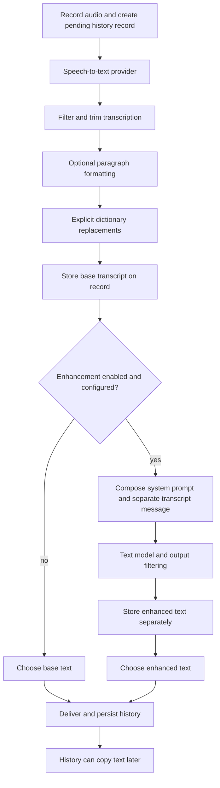

# VoiceInk cleanup, vocabulary, and transcript history: engineering study

Date: 21 October 2026. ToneTunner baseline: `791e86152fe025475bee7a987690951cde015f1e` on `beta-test-v1`. VoiceInk source: `Beingpax/VoiceInk` at `22e5ec5479b712797c3b338fcb875961e58800b6`, cloned into the maintainer's `inspiration folder`. This document is written before the implementation described below. Verification results will be appended after they exist.

## 1. The intended behavior and the mismatch in beta

The request is to understand and reproduce the useful parts of VoiceInk's cleanup algorithm: custom instructions belong in the enhancement model's system prompt; the transcript is input data; vocabulary supplies preferred spellings; and every recognized transcript remains available for later copying, including after successful insertion into another app. API keys should have appropriate Android protection.

The beta implementation already sends cleanup instructions and vocabulary in a system message. It does not have successful-transcript history. Its `RecoveryStore` keeps audio and raw-text checkpoints until delivery is accepted, then deletes the recovery entry. The main screen's Saved dictations dialog therefore means "recover unfinished delivery," not "all previous dictations." Installing an APK with that behavior cannot satisfy the history requirement, even when every recovery test passes.

The existing enhancement prompt is also much less specific than VoiceInk's. It describes generic punctuation/grammar editing, quotes the custom instructions as an additional string, and presents the entire vocabulary as another undifferentiated string. There is no deterministic dictionary correction. The algorithm must distinguish user-authored instructions, dictated source text, spelling hints, and explicit replacements.

## 2. Source map and provenance

The local clone is reference material and is excluded from ToneTunner's local Git status. It must not be vendored into the Android application or included in the PR. The following links pin the inspected version, rather than following a moving `main` branch:

| Responsibility | Inspected VoiceInk source |
|---|---|
| Built-in cleanup rules | [AIPrompts.swift](https://github.com/Beingpax/VoiceInk/blob/22e5ec5479b712797c3b338fcb875961e58800b6/VoiceInk/Core/Enhancement/AIPrompts.swift#L1-L56) |
| Wrapping versus verbatim custom prompts | [CustomPrompt.swift](https://github.com/Beingpax/VoiceInk/blob/22e5ec5479b712797c3b338fcb875961e58800b6/VoiceInk/Features/Enhancement/Models/CustomPrompt.swift#L42-L48) |
| System message, vocabulary, and request construction | [AIEnhancementService.swift](https://github.com/Beingpax/VoiceInk/blob/22e5ec5479b712797c3b338fcb875961e58800b6/VoiceInk/Features/Enhancement/Workflows/AIEnhancementService.swift#L152-L267) |
| Vocabulary retrieval | [CustomVocabularyService.swift](https://github.com/Beingpax/VoiceInk/blob/22e5ec5479b712797c3b338fcb875961e58800b6/VoiceInk/Features/Dictionary/Workflows/CustomVocabularyService.swift#L9-L24) |
| Literal replacement algorithm | [WordReplacementService.swift](https://github.com/Beingpax/VoiceInk/blob/22e5ec5479b712797c3b338fcb875961e58800b6/VoiceInk/Features/Dictionary/Workflows/WordReplacementService.swift#L31-L91) |
| Transcription/enhancement/delivery pipeline | [TranscriptionPipeline.swift](https://github.com/Beingpax/VoiceInk/blob/22e5ec5479b712797c3b338fcb875961e58800b6/VoiceInk/Features/Recording/Workflows/TranscriptionPipeline.swift#L104-L296) |
| Pending record before processing | [VoiceInkEngine.swift](https://github.com/Beingpax/VoiceInk/blob/22e5ec5479b712797c3b338fcb875961e58800b6/VoiceInk/Features/Recording/Workflows/VoiceInkEngine.swift#L194-L206) |
| Stored raw/enhanced text and request metadata | [Transcription.swift](https://github.com/Beingpax/VoiceInk/blob/22e5ec5479b712797c3b338fcb875961e58800b6/VoiceInk/Infrastructure/Persistence/Models/Transcription.swift#L11-L32) |
| Which version the history copies | [Transcription+History.swift](https://github.com/Beingpax/VoiceInk/blob/22e5ec5479b712797c3b338fcb875961e58800b6/VoiceInk/Features/History/Models/Transcription+History.swift#L3-L49) |
| History copy control | [HistoryComponents.swift](https://github.com/Beingpax/VoiceInk/blob/22e5ec5479b712797c3b338fcb875961e58800b6/VoiceInk/Features/History/Components/HistoryComponents.swift#L123-L130) |
| Transcript-retention controls | [HistorySettingsPanel.swift](https://github.com/Beingpax/VoiceInk/blob/22e5ec5479b712797c3b338fcb875961e58800b6/VoiceInk/Features/History/Views/HistorySettingsPanel.swift#L39-L92) |
| Separate audio cleanup | [AudioCleanupManager.swift](https://github.com/Beingpax/VoiceInk/blob/22e5ec5479b712797c3b338fcb875961e58800b6/VoiceInk/Infrastructure/Persistence/Cleanup/AudioCleanupManager.swift#L128-L145) |

The behavioral design below is independently implemented in Java. VoiceInk is GPLv3, as is ToneTunner, but sharing a license does not remove attribution obligations when copying code. Existing ToneTunner licenses, credits, DevilVed identity, application ID, and `.jules` logs remain required.

## 3. What the VoiceInk algorithm actually does

This is an orchestration algorithm, not a new speech-recognition neural network. The speech provider supplies words. Deterministic preprocessing supplies exact replacement rules. A separate text model performs cleanup based on instructions. Persistence and delivery are independent responsibilities.

### 3.1 The custom prompt becomes system-level instructions

VoiceInk's selected `CustomPrompt` has task text and a `useSystemInstructions` setting. With that setting enabled, `finalPromptText` inserts the task text into the shared cleanup template. With it disabled, the task text itself is used as the system prompt. `AIEnhancementService` appends vocabulary and enabled context sections, then passes the resulting string to the provider abstraction as `systemPrompt`. The transcript goes through a separate user message.

The wrapper establishes a transcription-editing contract. It covers meaning and language preservation, accidental repetitions and filler, spoken self-corrections, punctuation, readable paragraphs, numbers, and clear enumerations. It also tells the model to preserve spoken commands and questions as content instead of answering them. A sentence such as "tell me how to fix this error" should remain a sentence in a dictation, rather than cause the enhancer to troubleshoot the error.

The user's cleanup instructions refine this editing task. "Use bullet points for my shopping list" is an instruction from settings. The same words inside the recording are source material unless the selected task explicitly interprets spoken formatting cues. Message roles and clear source boundaries help the model distinguish the two. They are not a mathematical guarantee against prompt injection or hallucination.

VoiceInk also has a special hosted Refine path that bypasses the ordinary custom-prompt request construction. Claims about the regular BYOK prompt algorithm should not be generalized to that provider path.

### 3.2 Vocabulary is a spelling authority, not a replacement table

The vocabulary service retrieves and sorts entries. The enhancer receives a separate vocabulary section explaining that entries are preferred proper nouns, acronyms, product names, and technical terms. It can correct a phonetic transcription mistake when the surrounding sentence supports that interpretation. It should not insert every vocabulary item into the output.

For example, `ToneTunner` in vocabulary can help a model interpret "tone tuner" in a sentence about this application. It must not change an unrelated sentence about tuning a musical tone automatically. This remains a model judgment. Keeping `DevilVed` in the list also does not guarantee that a low-quality model will never rewrite it.

### 3.3 Explicit replacements provide deterministic corrections

VoiceInk has a distinct word-replacement service. It expands source variants, removes case-insensitive duplicates, and gives longer matches priority. For scripts with spaces it checks word boundaries; for some scripts without spaces it uses substring matching. The replacement is a literal string, not a regular-expression replacement program supplied by the user.

This is the right tool for a known repeated error: a user can explicitly map `tone tuner` to `ToneTunner`. It also works without an enhancement model. A plain vocabulary item cannot supply all its possible misrecognitions; guessing a large phonetic mapping would introduce false corrections.

### 3.4 History contains separate base and enhanced versions

VoiceInk creates a pending SwiftData record before processing begins. Its pipeline later populates `text` with the filtered/formatted/replacement-corrected transcript. Successful AI output is stored separately as `enhancedText`, along with model/prompt names and request messages. The history's preferred copy text selects valid enhanced output if available and otherwise selects the base transcript. An enhancement error message is not copied as if it were the user's dictation.

The inspected recording pipeline saves populated state after delivery returns. The pending record is already durable, but a pending row alone cannot preserve text that existed only in memory if the process dies before its later save. Android's implementation below deliberately saves recognized text before enhancement and saves final text before delivery.

Transcript auto-delete is disabled by default. Audio cleanup is separate: deleting an audio recording need not delete its transcript. Therefore "recording recovery" and "copyable transcript history" must have separate lifetimes.

### 3.5 Copy and paste are platform integration, not model work

History copy selects the stored preferred text and writes it to the clipboard. VoiceInk's live delivery can paste into the focused macOS application through its system integration. Android should keep its existing entry-point contracts: the keyboard uses its input connection, recognition callers receive Android results, and the standalone app exposes Copy. History copy explicitly puts user-selected text onto Android's clipboard for later paste. It does not need to read the clipboard or surrounding app text.

## 4. Android implementation design

### 4.1 Prompt construction

Extract prompt composition into a focused helper instead of burying policy in HTTP serialization. The normal mode uses an explicit cleanup template and inserts the saved custom instructions as instructions, not as a quoted transcript. A settings switch permits an advanced custom system prompt without the built-in cleanup template, matching VoiceInk's distinction. Transcript data remains a separate user message encoded as a JSON string so embedded markup cannot close its surrounding data structure.

Vocabulary is parsed from the existing comma/newline form, trimmed, deduplicated, and serialized as a JSON array under an explicit spelling-authority section. Existing saved strings remain readable. Names already correctly spelled in source text should keep their spelling. The prompt explains phonetic correction, avoids forced matches, and never treats vocabulary entries as instructions. Default cleanup preserves meaning/language, resolves unambiguous self-corrections, and improves paragraphs/lists without answering the transcript.

The advanced mode needs a nonempty custom prompt. It can legitimately request a shorter output, so the generic severe-shortening heuristic applies only to the built-in cleanup mode. Empty/refused/truncated/oversized responses still fail in either mode. The existing four-argument `CloudClient.enhance` remains compatible and uses built-in rules; the pipeline uses an overload carrying the selected mode.

Long dictations retain bounded text windows. This limits model context: an instruction spanning distant windows may not be applied globally, and list numbering can restart. This PR must describe that limitation rather than claim whole-document parity. The raw full transcript stays available if any enhancement window fails.

### 4.2 Predictable name corrections

Add a separate explicit replacement field, one `heard text => preferred text` rule per line. It must be available with enhancement disabled. Match literal Unicode text, case-insensitively, with boundaries for letters/digits/combining marks; do not replace `Ann` inside `Annette`. Prefer longer rules, perform a single pass over the original text, and do not recursively replace generated output. Treat `$` and backslashes as ordinary replacement characters. Preserve unrecognized names instead of guessing.

Apply replacements before enhancement and again to final output, because a text model can reintroduce a known misrecognition. Canonical vocabulary casing can be normalized on exact whole-term matches; phonetic vocabulary matching remains model-guided. Keep raw ASR text independently for history and retry. This Java implementation need not reproduce every script heuristic in VoiceInk; its boundary behavior must be explicit and tested.

### 4.3 Durable transcript history

Create `TranscriptHistoryStore` with a SQLite database inside app-private `noBackupFilesDir`. A stable recovery/session ID identifies one dictation across retries. `saveRaw(id, rawText, language)` writes recognized progress; `saveResult(id, rawText, text, language, warning)` writes the completed final or fallback text. Upserts preserve original creation time and avoid a second row for an explicit retry. No API key, authorization header, or complete HTTP request is stored.

The pipeline checkpoints raw text in recovery as it does today, also mirrors nonempty recognized progress into history, then persists the final result before scheduling delivery. A storage failure must preserve recovery and visibly report the problem; it must not silently claim history was saved. Empty recordings create no blank history. Cancelled processing retains any completed-window progress. Cancelling an active capture before recognition cannot save words that have not been recognized.

A separate Transcript history screen lists recent entries in pages, opens the full stored text, and offers Copy result, Copy raw transcript when different, and Delete with confirmation. Text remains until explicit deletion or uninstall. Successful delivery may delete recovery audio as before; that does not delete history. Deleting text history does not silently discard a separately recoverable audio entry. A later explicit retry may create that text again.

The history database is app-private and excluded from backup, but it is not separately encrypted by this iteration. Device encryption and Android sandboxing are the baseline, as for existing recovery data. Root access, an authorized debugger on a debug APK, or a compromised app process are outside that confidentiality guarantee. Copy deliberately exposes selected text to the system clipboard and target application.

### 4.4 API-key storage and privacy corrections

The baseline already has AES-GCM encryption under an Android Keystore key, randomized nonces, authenticated provider/stage/full-endpoint identity, atomic file writes, and no-backup storage. Existing tests cover tampering, key separation, no plaintext preferences, and the production Keystore. Replacing it with another preferences library is not a security improvement by itself.

Keep this storage architecture. Explicitly exclude key input from Android Content Capture as well as autofill/saved view state, retaining password masking, no-personalized-learning, and `FLAG_SECURE`. Current automatic capture heuristics appear to exclude the programmatic field, so this is hardening against future UI/framework changes, not a demonstrated current leak. Hardware backing is device-dependent; the app must not promise StrongBox on all phones or claim that encrypted storage prevents an already compromised process from using credentials. Biometric prompts per request would disrupt recognition-service workflows and are not introduced.

The merged history audit found two more concrete bugs. First, an absent AI provider preference defaults to Groq, stranding existing local users behind cloud consent; an upgrade should retain local behavior. Second, OpenRouter documents that transcription does not support the chat endpoint's per-request routing/data-policy controls. ToneTunner must reject OpenRouter transcription with required ZDR before uploading audio, rather than send an ignored `provider.zdr` field and claim protection. Users can explicitly opt out of that requirement under a truthful disclosure. Chat enhancement keeps its documented ZDR routing. Provider-discovery network/authentication errors must also be distinguished from local secure-storage failures.

## 5. Alternatives and why this design was selected

| Option | Benefit | Limitation / decision |
|---|---|---|
| Only strengthen the prompt | Small change | Does not create history or deterministic name fixes; insufficient |
| Keep recovery entries forever | Reuses storage | Retains large audio, mixes retry with ordinary copy, loses separate raw/final semantics; rejected |
| New durable text history, existing audio recovery | Bounded list queries, separate lifetimes, raw/final views | Adds a small database/UI; selected |
| Copy the entire VoiceInk subsystem | Similar feature set | Swift/macOS dependencies and unnecessary source/license coupling; independent Java implementation selected |
| Cloud history/account sync | Cross-device access | New service, privacy and credentials; outside the requested local feature |

## 6. Verification and acceptance boundary

All Android compilation, executable tests, lint, emulator runs, and APK assembly use GitHub Actions. The development Mac has no Android SDK. New regression assertions should first fail against the beta behavior, then pass after repairs. The final PR targets `beta-test-v1`, with no release tag or version bump.

The required checks cover prompt message roles and exact custom text, JSON vocabulary/data separation, Unicode and metacharacter replacements, collision boundaries and non-cascading rules, raw/final history durability across reopening, retry upsert, deletion, paging, history persistence after accepted/rejected delivery, enhancement fallback and cancellation, content-capture exclusion, local defaults, and rejecting unenforceable ZDR before a request. Existing ownership/recovery suites remain part of the gate. Runtime tests open the history/settings screens on the existing API matrix.

These controlled tests establish application behavior, not speech/model quality. No paid provider calls or user keys are needed. Real-phone/editor behavior, noisy audio, phonetic vocabulary accuracy, and instruction adherence across long text windows still need user acceptance. An enhancement prompt is not a guarantee of verbatim fidelity.

## 7. Commit review since the previous Codex work

The previous chat ended around `084cd96`. All 19 following commits through merge `791e861` were inspected, including test-only and documentation commits. The full-merge history was preserved.

| Commit | Result |
|---|---|
| `11eda74` | Corrected recognition delivery callback fixture |
| `554b1ee` | Added deliberately failing audio/lifecycle/provider regressions |
| `01bd79c` | Corrected credential-thread and translation fixtures |
| `85e9ba1` | Repaired recording ownership, recovery, lifecycle, cloud settings and native setup |
| `943e0e6` | Corrected missing-ABI fixture |
| `c5a3d16` | Preserved gesture intent, serialized settings writes, archived service capture |
| `ea6fc60` | Corrected detected language and cancellation/recovery messages |
| `5c25c1d` | Corrected first-run JVM fixtures and recorder seam |
| `3a04b5f` | Skipped invalid short cloud-audio tails; fixed singular count |
| `78a1722` | Recorded review dispositions and verified integration |
| `3314598` | Recorded beta PR target |
| `a0462fb` | Addressed CodeQL ownership/stream/bounds findings |
| `0213369` | Corrected variable collision introduced by that cleanup |
| `3b3af85` | Recorded CodeQL verification |
| `8a5e140` | Added emulator reproduction for Android 15 settings crash |
| `c520747` | Fixed settings crash/insets and added API 36 |
| `b629a43` | Added central Settings screen |
| `97b6899` | Repaired model-screen navigation; documented Android 15/16 |
| `791e861` | Full merge into `beta-test-v1` |

Some older README/PR verification text attributes API 36 coverage to `0213369`, before that matrix entry existed. The later full beta application run is [39544604048 on `97b6899`](https://github.com/DevilVed/ToneTunner/actions/runs/39544604048), with [Code checks 39544603934](https://github.com/DevilVed/ToneTunner/actions/runs/39544603934). New evidence must be attached to the actual tested revision rather than inherited from those historical green badges.

## 8. Implementation and verification record

At document creation, implementation has not started. This section will record final interfaces, test results, review corrections, and any departures from the design once they are observed.
